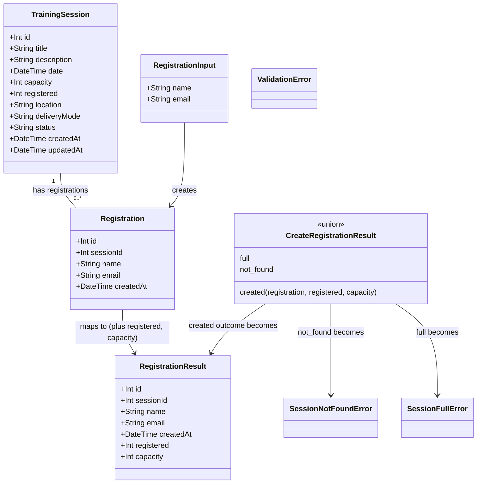

# Employee Registers for an Available Training Session

## Requirements

Enable employees to secure a place in a training session by submitting their name and email, while guaranteeing that a session is never booked beyond its capacity and that the employee immediately sees the confirmation and the updated capacity.

Boundaries: registration only. Duplicate prevention, waitlisting (WH-3), cancellation (WH-4), email notification (WH-8) and authentication are excluded. Registration is already implemented on `main` (PR #1), so this canvas describes the contract to preserve and verify, and any change must be additive and backward compatible.

## Entities

No entity changes are required. The stored `registered` count on `TrainingSession` is kept as the single seat counter, and `Registration` keeps its current shape.

## Approach

1. Solution Category: Atomic seat claim
   - Store the seat count on the session row, as clarified, and make one database transaction the only write path for registrations.
   - Claim a seat with a single conditional increment that succeeds only while `registered < capacity`. This protects the capacity invariant under concurrency without explicit locks and suits a single-writer SQLite store.
   - Insert the registration in the same transaction, so a registration exists if and only if a seat was claimed.
   - If the claim changes no rows, a follow-up lookup in the same transaction distinguishes a full session from a missing one.

2. Technical Implementation:
   - Express route → service → repository layering. The route parses the session id and maps typed domain errors to HTTP status codes. The service validates and trims input and translates repository outcomes. Only the repository touches Prisma.
   - The repository returns a discriminated union outcome (created, full, not_found), so expected business failures are values, not exceptions.
   - Transaction wait and timeout limits are raised above Prisma's defaults, because concurrent writers queue for the SQLite write lock.
   - Error handling: there is no global business-exception handler in this codebase. Typed errors are mapped in the route handler, with unexpected errors logged and returned as a generic 500. Keep this pattern; do not introduce a new framework.
   - UI: the page owns the API call and the in-place count update. The card owns the form, a submitting state, the confirmation message and the error message.

3. Business Logic:
   - Name and email are required, trimmed, and bounded (name at most 100 characters, email at most 254), and the email must have a basic valid shape. Any failure is a 400 and creates nothing and consumes no seat.
   - A malformed (non-numeric) session id is a 400. A missing session is a 404. A full session is a 409. Success is a 201.
   - Validation is performed before touching the database, so with an invalid body and a missing session the 400 takes precedence.
   - The success response returns the registration together with the updated `registered` and `capacity`, so the card updates without a refetch.
   - A full card disables the fields and button and shows a "Full" badge.

## Structure

### Inheritance Relationships

1. `ValidationError`, `SessionNotFoundError` and `SessionFullError` each extend `Error` and set a distinct `name`.
2. `CreateRegistrationResult` is a discriminated union on `status`, with no class hierarchy.
3. `RegistrationResult` is the Prisma `Registration` type extended with `registered` and `capacity`.

### Dependencies

1. The training-sessions router depends on `registerForSession` (service) and the three error classes.
2. `registrationService` depends on `registrationRepository` and the error classes.
3. `registrationRepository` depends on the Prisma client (`lib/prisma`) only.
4. `TrainingSessionsPage` depends on `TrainingSessionCard` and the shared types.
5. `TrainingSessionCard` receives `onRegister` as a prop and has no network knowledge.

### Layered Architecture

1. Route layer (`api/src/routes/training-sessions.ts`): parse the id, call the service, map errors to 400 / 404 / 409 / 500, return 201 on success.
2. Service layer (`api/src/services/registrationService.ts`): validate and normalise input, call the repository, translate outcomes into results or typed errors.
3. Repository layer (`api/src/repositories/registrationRepository.ts`): own the transaction, the conditional seat claim and the registration insert.
4. Data layer: Prisma models `TrainingSession` and `Registration` (SQLite).
5. Error handling: typed errors in `api/src/errors.ts`, mapped at the route.
6. Web layer: page (`TrainingSessionsPage`) for the request and state; card (`TrainingSessionCard`) for the form and messages; shared types in `app/src/types`.

## Operations

### Verify Route - POST /api/training-sessions/:id/registrations

1. Responsibility: expose registration over HTTP and map outcomes to status codes.
2. Methods:
   - handler(req, res): void
     - Logic:
       - Parse `:id` with base 10. If not a number, respond 400 `{ error: 'Invalid session ID' }`.
       - Call `registerForSession(id, req.body)`.
       - On success respond 201 with the result.
       - Map `ValidationError` to 400, `SessionNotFoundError` to 404 and `SessionFullError` to 409, each as `{ error: message }`.
       - Any other error is logged and answered with 500 `{ error: 'Failed to register for training session' }`.
3. Constraints: no direct Prisma access in this handler. Do not alter the search endpoint in the same file.

### Verify Service - registerForSession

1. Interface Definition: `registerForSession(sessionId: number, input: unknown): Promise<RegistrationResult>`.
2. Core Methods:
   - Input Validation: treat a non-object body as empty. `name` and `email` must be non-empty strings after trimming, at most 100 and 254 characters respectively, and the email must match a basic address pattern. Otherwise throw `ValidationError` with a field-specific message.
   - Business Logic: call `createRegistration(sessionId, { name, email })` with the trimmed values.
   - Exception Handling: `not_found` throws `SessionNotFoundError`, `full` throws `SessionFullError`.
   - Return Value: `{ ...registration, registered, capacity }`.
3. Dependency Injection: module imports, with no `any`. `unknown` input is narrowed explicitly.
4. Transaction Management: none here. The repository owns it.

### Verify Repository - createRegistration

1. Responsibility: claim a seat and record the registration atomically.
2. Methods:
   - createRegistration(sessionId: number, input: RegistrationInput): Promise<CreateRegistrationResult>
     - Logic:
       - Run in one Prisma transaction with raised wait (10 s) and timeout (15 s) limits.
       - Execute a conditional `UPDATE training_sessions SET registered = registered + 1 WHERE id = ? AND registered < capacity`, with bound parameters.
       - If zero rows changed, look up the session. Return `full` if it exists and `not_found` if it does not.
       - Otherwise create the `Registration` row, read back `registered` and `capacity`, and return `created`.
       - If the session vanishes mid-transaction, throw so that the transaction rolls back.
3. Constraints: this is the only code path that writes to `registered` for registrations. Raw SQL stays parameterised.

### Verify UI - TrainingSessionsPage.handleRegister

1. Responsibility: post the registration and update the matching session in state.
2. Logic:
   - POST JSON `{ name, email }` to the registrations endpoint.
   - If the response is not OK, read the `error` field from the body, falling back to `Registration failed: <status>`, and throw so the card shows it.
   - On success, update only `registered` and `capacity` for that session from the response.

### Verify UI - TrainingSessionCard

1. Responsibility: render the registration form, confirmation and errors.
2. Logic:
   - Compute `spotsLeft = capacity - registered` and `isFull = spotsLeft <= 0`.
   - Render name and email inputs (both required) and a Register button on every card.
   - When full, disable the inputs and the button and show the "Full" badge.
   - While submitting, disable the button.
   - On success, show "You are registered for <title>." (role `status`) and clear the fields. On failure, show the error message (role `alert`).

### Verify Tests - Red/Green coverage per acceptance criterion

1. Responsibility: ensure each AC is covered. Add only the missing tests and change no production code unless one fails.
2. Coverage to confirm:
   - 201 with registration details and `registered` incremented by one.
   - 400 for an empty body, a missing name, a missing email, oversized values (exact boundary 100/254 accepted, 101/255 rejected, with no seat consumed), and a non-numeric id.
   - 404 for a missing session. 409 for a full session.
   - Last seat succeeds, then the next request gets 409.
   - Concurrent requests never push `registered` above `capacity`.
   - UI: the form is visible on each card, the full card is disabled with a badge, a confirmation appears on success, and the error message appears on failure.
3. Verification: `make test` and `make lint` pass.

## Norms

1. Annotation / typing standards: strict TypeScript. No `any`; use `unknown` with narrowing, generics or discriminated unions.
2. Dependency injection: plain module imports. The route calls the service and only the repository touches Prisma. The card receives behaviour through props.
3. Exception handling:
   - Domain errors are classes in `api/src/errors.ts` that extend `Error` and set `name`.
   - Expected outcomes cross the repository boundary as union values, and the service converts them into typed errors.
   - The route maps typed errors to `{ error: string }` bodies. Unexpected errors are logged server-side and returned as a generic 500 message.
4. Data validation: validate in the service before any database access. Trim strings, enforce the length limits, and check the email shape.
5. Logging: log only unexpected errors, with context in the message, and never log request bodies containing email addresses.
6. Documentation standards: comment the non-obvious "why" only (for example the transaction limits and the atomic claim). Match the density of the surrounding code.
7. Process: Red-Green-Refactor TDD, and every change passes `make test` and `make lint`. Never commit secrets or `.env` files.

## Safeguards

1. Functional Constraints: `registered` must never exceed `capacity`. A registration row exists if and only if a seat was claimed. Failed validation or a full or missing session creates no row and changes no count.
2. Performance Constraints: registrations on one session are serialised by the single-writer store. Waiting must stay within the 10 s wait and 15 s transaction limits. The response needs no extra refetch.
3. Security Constraints: all SQL uses bound parameters. Do not widen the existing raw-SQL search endpoint, which is a known out-of-scope security seed. Error responses expose only the message, never stack traces, and the registration routes must not add any.
4. Integration Constraints: the endpoint stays `POST /api/training-sessions/:id/registrations`. Existing consumers rely on the 201 body fields (registration fields plus `registered` and `capacity`). Changes must be additive.
5. Business Rule Constraints: out of scope and must not be implemented here: duplicate prevention, waitlist, cancellation, notification, authentication.
6. Exception Handling Constraints:
   - Every expected failure maps to exactly one status: 400, 404 or 409.
   - Error messages are clear and contain no internal details.
   - Typed errors are mapped in the route. Do not introduce a new global handler as part of this story.
7. Technical Constraints: no `any`. No direct Prisma in routes or services. `registered` is written only through the repository transaction. No new dependencies.
8. Data Constraints: name at most 100 and email at most 254 characters after trimming. Both are non-empty and the email has a basic valid shape. The `Registration` schema is unchanged.
9. API Constraints: 201 success, 400 for invalid id or body, 404 for a missing session, 409 for a full session, 500 for unexpected errors. Error bodies are `{ error: string }`. Where the body is invalid and the session is missing, 400 takes precedence.
