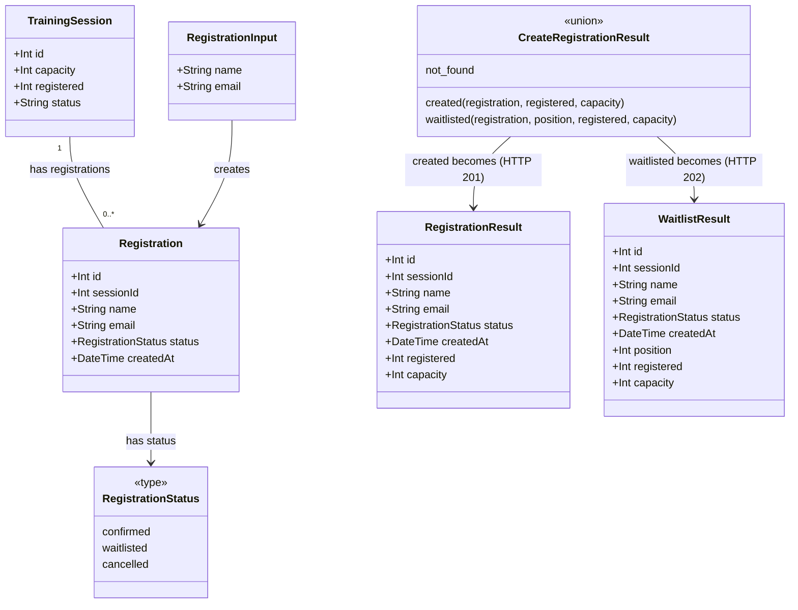

# Waitlist When a Training Session Is Full

## Requirements

Capture employee demand for full training sessions by placing them on an ordered waitlist instead of turning them away, and tell each employee clearly whether they are confirmed or only waitlisted (and where they stand in line).

Boundaries: joining the waitlist only. Promotion from the waitlist (WH-5), cancellation (WH-4), email notification (WH-8) and a maximum waitlist size are excluded. This replaces the current "full session returns 409" behaviour from LATC-2, and every other LATC-2 behaviour (validation, 400 and 404 handling, the capacity guarantee) stays unchanged.

## Entities

Only `Registration` gains a field (`status`). `TrainingSession` is unchanged: `registered` keeps counting confirmed seats only. The waitlist is not a separate entity; it is the set of `Registration` rows with status `waitlisted` for a session. The waitlisted count and each position are computed from those rows, not stored. `cancelled` exists in the type for WH-4 but is never produced here.

## Approach

1. Solution Category: Extend the existing registration flow
   - Keep the single endpoint `POST /api/training-sessions/:id/registrations`. It now has two success outcomes: confirmed (201) and waitlisted (202).
   - Keep the atomic conditional seat claim from LATC-2. If the claim succeeds the employee is confirmed. If it changes no rows and the session exists, the employee is waitlisted in the same transaction, so the confirmed-or-waitlisted decision is always consistent with the seat count.
   - Add `status` to `Registration` with default `confirmed`, so existing rows and the confirmed path need no data migration.
   - Derive the position from join order within the session (the waitlisted registrations ordered by id), computed inside the transaction after the insert. Do not store a position or a waitlist counter.

2. Technical Implementation:
   - Prisma/SQLite: `status` is a `String` with default `"confirmed"`, matching how `TrainingSession.status` is already modelled (SQLite has no native enum). The TypeScript type `RegistrationStatus` narrows it. Apply the schema with `prisma db push`, as the repo does.
   - The repository outcome union changes from created / full / not_found to created / waitlisted / not_found. `full` disappears because a full session is now a valid outcome.
   - SQLite serialises writers, so two concurrent waitlist joins cannot read the same position count. The transaction limits from LATC-2 stay.
   - Error handling: keep route-level mapping of typed errors (no global handler exists). `SessionFullError` is no longer reachable and is removed together with its mapping.
   - UI: the page branches on the response outcome. The card shows a distinct message for each outcome.

3. Business Logic:
   - Only confirmed registrations increase `registered`. A waitlisted registration never changes it.
   - Response bodies are additive: the 201 body keeps all LATC-2 fields and gains `status: "confirmed"`. The 202 body carries `status: "waitlisted"` and `position`, plus the registration fields and the unchanged `registered` and `capacity`.
   - Validation, id parsing, 400 precedence over 404, and the 404 for a missing session are unchanged. Invalid input must never create a waitlist entry.
   - There is no duplicate prevention and no session-status gate, as in LATC-2.
   - The full card keeps its "Full" badge and keeps the form enabled, with the button relabelled "Join Waitlist".

## Structure

### Inheritance Relationships

1. `ValidationError` and `SessionNotFoundError` extend `Error` (unchanged). `SessionFullError` is removed.
2. `RegistrationStatus` is a string-literal union type.
3. `CreateRegistrationResult` is a discriminated union on `status` with members `created`, `waitlisted`, `not_found`.
4. `RegistrationResult` and `WaitlistResult` are the service return types for the two success outcomes. The service returns a union of them, discriminated by `status`.

### Dependencies

1. The training-sessions router depends on `registerForSession` and the remaining error classes. It picks 201 or 202 from the result's `status`.
2. `registrationService` depends on `registrationRepository` and the error classes.
3. `registrationRepository` depends on the Prisma client only.
4. `TrainingSessionsPage` depends on `TrainingSessionCard` and the shared types, and passes `onRegister` returning the outcome.
5. `TrainingSessionCard` depends on the shared response types and no network code.

### Layered Architecture

1. Route layer: parse the id, call the service, return 201 for confirmed and 202 for waitlisted, map `ValidationError` to 400 and `SessionNotFoundError` to 404, and anything else to a generic 500.
2. Service layer: validate and trim input (unchanged), call the repository, convert the outcome into a result or typed error.
3. Repository layer: own the transaction, the conditional seat claim, the registration insert with its status, and the position calculation.
4. Data layer: `Registration.status` added to the Prisma schema.
5. Error handling: typed errors in `api/src/errors.ts`, mapped at the route.
6. Web layer: page performs the request and updates counts only for confirmed outcomes. Card renders the form, the outcome-specific message, and errors.

## Operations

### Update Schema - Registration status

1. Responsibility: record whether a registration holds a seat or is waitlisted.
2. Attributes:
   - `status`: `String` - `@default("confirmed")`, expected values `confirmed | waitlisted | cancelled`.
3. Steps:
   - Add `status String @default("confirmed")` to the `Registration` model.
   - Add an index on `[sessionId, status]` to support waitlist counting.
   - Regenerate the Prisma client and apply with `prisma db push`.
4. Constraints: existing rows read as `confirmed`. No other model changes. The seed file keeps working because the default applies.

### Update Types - RegistrationStatus

1. Responsibility: type-safe statuses and responses.
2. Methods and shapes:
   - API: `type RegistrationStatus = 'confirmed' | 'waitlisted' | 'cancelled'`.
   - API: `RegistrationResult` gains `status: RegistrationStatus`. Add `WaitlistResult` as `RegistrationResult` plus `position: number`.
   - Web (`app/src/types`): `RegistrationResponse` gains `status`. Add optional `position?: number`, or a discriminated union on `status`. No `any`.
3. Constraints: the 201 shape remains a superset of the LATC-2 shape.

### Update Repository - createRegistration

1. Responsibility: confirm or waitlist atomically.
2. Methods:
   - createRegistration(sessionId: number, input: RegistrationInput): Promise<CreateRegistrationResult>
     - Logic:
       - Run in one transaction with the existing wait and timeout limits.
       - Run the conditional `UPDATE ... SET registered = registered + 1 WHERE id = ? AND registered < capacity`.
       - If one row changed: insert the registration with status `confirmed`, read back `registered` and `capacity`, return `created`.
       - If zero rows changed: look up the session. If it is missing, return `not_found`.
       - Otherwise insert the registration with status `waitlisted`. Compute `position` as the count of waitlisted registrations for the session with `id` less than or equal to the new row's id. Read `registered` and `capacity` (unchanged) and return `waitlisted`.
       - A vanished session mid-transaction throws, which rolls back.
3. Constraints: `registered` is incremented only on the confirmed path. Raw SQL stays parameterised.

### Update Service - registerForSession

1. Interface Definition: `registerForSession(sessionId: number, input: unknown): Promise<RegistrationResult | WaitlistResult>`.
2. Core Methods:
   - Input Validation: unchanged from LATC-2 (trim, required, 100/254 limits, email shape).
   - Business Logic: call the repository.
   - Exception Handling: `not_found` throws `SessionNotFoundError`. The `full` case no longer exists.
   - Return Value: `created` gives `{ ...registration, registered, capacity }` with `status: 'confirmed'`. `waitlisted` gives `{ ...registration, position, registered, capacity }` with `status: 'waitlisted'`.
3. Transaction Management: none here.

### Update Route - POST /api/training-sessions/:id/registrations

1. Responsibility: choose the HTTP status from the outcome.
2. Logic:
   - Invalid id gives 400 (unchanged).
   - Result `status === 'waitlisted'` gives 202 with the body. Result `status === 'confirmed'` gives 201.
   - `ValidationError` gives 400, `SessionNotFoundError` gives 404. Remove the `SessionFullError` branch and import.
   - Any other error is logged and returns a generic 500.
3. Constraints: do not touch the `/search` endpoint in the same file.

### Remove Error - SessionFullError

1. Responsibility: delete the now-unreachable error class from `api/src/errors.ts` and every import, so lint stays clean.

### Update UI - TrainingSessionsPage.handleRegister

1. Responsibility: return the outcome to the card and update counts only when confirmed.
2. Logic:
   - Change the signature to return `Promise<RegistrationResponse>` (including `status` and optional `position`).
   - Treat any OK response (201 or 202) as success. Non-OK still throws using the body's `error` message.
   - Update the session's `registered` and `capacity` from the response only when `status === 'confirmed'`. For waitlisted, leave the count unchanged.

### Update UI - TrainingSessionCard

1. Responsibility: show the Join Waitlist option and outcome-specific messages.
2. Logic:
   - Keep `isFull = capacity - registered <= 0` and the "Full" badge.
   - When full: keep the inputs enabled, label the button "Join Waitlist", and show a short hint that the session is full.
   - On a confirmed outcome: "You are registered for <title>." (role `status`).
   - On a waitlisted outcome: "You are on the waitlist for <title> at position <N>. Your place is not confirmed." (role `status`).
   - Disable the button only while submitting. Errors still use role `alert`.

### Update Tests - replace the 409 contract

1. Responsibility: replace tests that assert 409 for a full session, and add waitlist coverage (write failing tests first, then implement).
2. Coverage:
   - Integration: full session gives 202 with `status: "waitlisted"` and `position: 1`; a second join gives position 2; `registered` is unchanged; the waitlisted row has status `waitlisted` in the database.
   - Integration: a session with space gives 201 with `status: "confirmed"` and the row is `confirmed`.
   - Integration: the last seat is confirmed, then the next request is waitlisted.
   - Integration: invalid body gives 400 with no row created; missing session gives 404.
   - Integration concurrency: with capacity 3 and 10 concurrent requests, exactly 3 return 201 and 7 return 202 with distinct positions 1 to 7, `registered` is 3, and the waitlisted count is 7.
   - Unit repository and service: the `created`, `waitlisted` and `not_found` outcomes; position is computed per session.
   - UI: the full card shows "Join Waitlist" with an enabled form; a waitlisted submission shows the not-confirmed message with the position and leaves the count unchanged; a confirmed submission still updates the count.
3. Verification: `make test` and `make lint` pass.

## Norms

1. Typing standards: strict TypeScript, no `any`. Use `unknown` with narrowing and discriminated unions on `status`. Replace the removed `full` handling instead of casting around it.
2. Dependency injection: plain module imports. Only the repository touches Prisma. The card gets behaviour through props.
3. Exception handling:
   - Typed errors live in `api/src/errors.ts` and extend `Error`.
   - Expected outcomes cross the repository boundary as union values.
   - The route maps typed errors to `{ error: string }` and logs unexpected errors with a generic 500 body.
4. Data validation: unchanged service-level validation, applied identically to confirmed and waitlisted joins.
5. Logging: log only unexpected errors, and never request bodies containing email addresses.
6. Documentation standards: comment only the non-obvious "why" (for example why position is derived and why the decision is inside the transaction). Match surrounding comment density.
7. Process: Red-Green-Refactor TDD, `make test` and `make lint` must pass, and never commit secrets or `.env` files.

## Safeguards

1. Functional Constraints: `registered <= capacity` always. Only confirmed registrations count toward `registered`. A waitlisted registration never changes it. Invalid input, a missing session, or a rollback creates no registration row.
2. Performance Constraints: confirm-or-waitlist runs in one transaction within the existing 10 s wait and 15 s timeout limits. Position is computed with one indexed count query. No stored counters.
3. Security Constraints: bound parameters for all SQL. Error responses expose only the message, and do not add stack traces to these routes. Do not widen the raw-SQL search endpoint.
4. Integration Constraints: the 201 body stays a superset of the LATC-2 body. The only contract change is that a full session now returns 202 instead of 409. The page must treat 202 as success without updating the seat count.
5. Business Rule Constraints: positions follow join order, start at 1, and are consecutive and unique among current waitlisted registrations for the session, including under concurrent joins. Out of scope and not to be implemented: promotion, cancellation, notification, a waitlist cap, duplicate prevention.
6. Exception Handling Constraints:
   - Every expected failure maps to one status: 400 for an invalid id or body, 404 for a missing session.
   - A full session is not an error. Remove `SessionFullError`.
   - Error messages carry no internal details.
7. Technical Constraints: no `any`. No direct Prisma in routes or services. `registered` is written only in the repository's confirmed path. No new dependencies. Schema change limited to `Registration.status` (default `confirmed`) and its index.
8. Data Constraints: `status` is one of `confirmed`, `waitlisted`, `cancelled`, and this story writes only the first two. Existing rows must read as `confirmed`. Name and email limits are unchanged (100 and 254).
9. API Constraints: 201 for confirmed with `status: "confirmed"`. 202 for waitlisted with `{ status: "waitlisted", position }` plus registration details, `registered` and `capacity`. 400, 404 and 500 are unchanged. A full session never returns 409.
