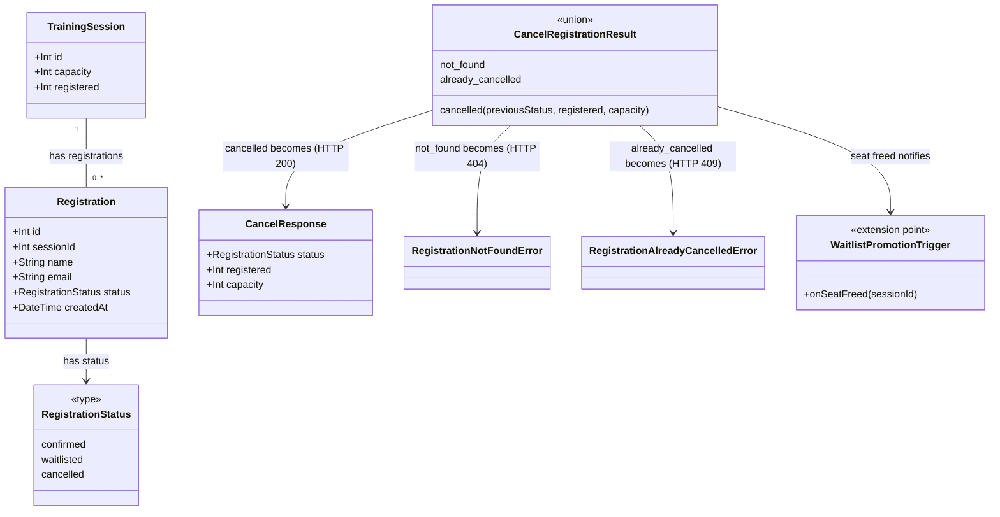

# Cancel Registration

## Requirements

Let an employee release their place in a training session by cancelling their registration with the registration id, so the seat is returned to the session (and can be offered to the waitlist) and the employee sees a clear confirmation and the updated capacity.

Boundaries: cancellation by the registration holder only. Email confirmation (WH-8), cancellation by an organiser, authentication, and the waitlist promotion rules (WH-5) are excluded. Only the trigger point for promotion is in scope. Cancellation builds on the registration (LATC-2) and waitlist (LATC-3) behaviour already on `main`, and none of that behaviour changes.

## Entities

No schema change is needed. `Registration.status` already exists and `cancelled` is already an allowed value. The row is kept (a soft cancel), so a second cancel can be reported as a conflict. `TrainingSession.registered` keeps counting confirmed seats only. Waitlist position stays derived from waitlisted rows, so removing a waitlisted registration moves later ones up with no extra work.

## Approach

1. Solution Category: Inverse of the seat claim
   - Add the inverse of registration: a cancel operation reached through `DELETE /api/training-sessions/:id/registrations/:registrationId`, using the same route → service → repository layering.
   - Keep the registration row and move its status to `cancelled` (soft cancel). A hard delete would make "already cancelled" indistinguishable from "not found".
   - Do the status change and the seat release in one transaction. The status change decides whether a seat is given back: only a registration that was `confirmed` releases a seat, and only the request that actually performs the change releases it. Two simultaneous cancels of the same registration therefore release one seat.
   - A waitlisted registration may also be cancelled at the API. It releases no seat, and it leaves the waitlist.

2. Technical Implementation:
   - Prisma/SQLite: the repository reads the registration scoped to the session, then performs a conditional status update (`status` must still equal the value just read). If that update changes no rows, a concurrent cancel won, and the outcome is `already_cancelled`.
   - Seat release is a conditional decrement (`registered > 0`), the mirror of the conditional claim, so the count can never go negative.
   - The repository returns a discriminated union (`cancelled | not_found | already_cancelled`). The service converts failures into typed errors. The route maps them to 404 and 409, with 400 for malformed ids.
   - Promotion is a named hand-off, `onSeatFreed(sessionId)`, called by the service after the transaction commits and only when a seat was released. It does nothing yet; WH-5 will give it behaviour. Keeping it outside the transaction means a future promotion failure cannot undo a valid cancellation.
   - Error handling: keep route-level mapping of typed errors (there is no global handler). Unexpected errors are logged and returned as a generic 500.
   - UI: the page owns the request and updates the seat count from the response. The card remembers the registration it just created so it can offer Cancel, asks for confirmation with `window.confirm`, and shows the outcome.

3. Business Logic:
   - Only an active registration can be cancelled: `confirmed` releases a seat, `waitlisted` releases none, `cancelled` is a 409.
   - A registration must belong to the session in the URL. If it does not, or does not exist, the answer is the same 404.
   - Ids that are not whole numbers are rejected with 400 before any database work.
   - The success body is `{ status: 'cancelled' }` plus the updated `registered` and `capacity`, so the card needs no refetch. The extra fields are additive.
   - Known limitation, out of scope here: until WH-5 exists, a freed seat can be claimed by a brand-new registration ahead of waitlisted people. The registration id is also a guessable sequential number and is the only identity check, as the story accepts for training.

## Structure

### Inheritance Relationships

1. `RegistrationNotFoundError` and `RegistrationAlreadyCancelledError` extend `Error` and set a distinct `name`, like the existing errors.
2. `CancelRegistrationResult` is a discriminated union on `status`.
3. `RegistrationStatus` already exists in the service module and is reused. The web type of the same name is reused as well.
4. `onSeatFreed` is a plain function in its own module, so WH-5 can fill it in without touching the cancel flow.

### Dependencies

1. The training-sessions router depends on `cancelRegistration` (service) and the new error classes.
2. `registrationService` depends on `registrationRepository`, `waitlistPromotion` and the error classes.
3. `registrationRepository` depends on the Prisma client only.
4. `TrainingSessionsPage` depends on `TrainingSessionCard` and the shared types, and supplies `onCancel`.
5. `TrainingSessionCard` receives `onRegister` and `onCancel` as props and has no network knowledge.

### Layered Architecture

1. Route layer: parse both ids, call the service, return 200 with the body, map `RegistrationNotFoundError` to 404 and `RegistrationAlreadyCancelledError` to 409, and anything else to a generic 500.
2. Service layer: validate the ids, call the repository, convert outcomes, and call `onSeatFreed` after a successful release.
3. Repository layer: own the transaction, the status change and the conditional seat release.
4. Data layer: existing `Registration` and `TrainingSession` models, unchanged.
5. Error handling: typed errors in `api/src/errors.ts`, mapped at the route.
6. Web layer: page performs the `DELETE` and updates counts. Card holds the registration state, the confirmation step and the messages.

## Operations

### Create Errors - RegistrationNotFoundError, RegistrationAlreadyCancelledError

1. Responsibility: typed outcomes for the two failure cases.
2. Methods:
   - `RegistrationNotFoundError`: constructor with no arguments, message `Registration not found`, name `RegistrationNotFoundError`.
   - `RegistrationAlreadyCancelledError`: constructor with no arguments, message `Registration is already cancelled`, name `RegistrationAlreadyCancelledError`.
3. Constraints: add to `api/src/errors.ts` next to the existing errors. Messages contain no internal detail.

### Create Module - waitlistPromotion

1. Responsibility: the hand-off point for waitlist promotion (WH-5).
2. Methods:
   - onSeatFreed(sessionId: number): Promise<void>
     - Logic:
       - Does nothing for now. A comment states that WH-5 will promote the first waitlisted registration here.
3. Constraints: file `api/src/services/waitlistPromotion.ts`. No database access and no behaviour until WH-5.

### Update Repository - cancelRegistration

1. Responsibility: cancel a registration and give back its seat atomically.
2. Methods:
   - cancelRegistration(sessionId: number, registrationId: number): Promise<CancelRegistrationResult>
     - Logic:
       - Run in one transaction with the existing wait (10 s) and timeout (15 s) limits.
       - Find the registration by id and `sessionId`. If it is missing, return `not_found`.
       - If its status is `cancelled`, return `already_cancelled`.
       - Update the registration to `cancelled` only where id matches and the status still equals the value just read. If no row changed, a concurrent cancel won; return `already_cancelled`.
       - If the previous status was `confirmed`, run `UPDATE training_sessions SET registered = registered - 1 WHERE id = ? AND registered > 0`, with bound parameters.
       - Read `registered` and `capacity` for the session and return `{ status: 'cancelled', previousStatus, registered, capacity }`.
3. Constraints: this and the registration transaction are the only writers of `registered`. A waitlisted cancellation must not touch `registered`.

### Update Service - cancelRegistration

1. Interface Definition: `cancelRegistration(sessionId: number, registrationId: number): Promise<CancelResponse>`.
2. Core Methods:
   - Input Validation: both ids must be positive whole numbers; otherwise throw `ValidationError`.
   - Business Logic: call the repository. If a seat was released (previous status `confirmed`), call `onSeatFreed(sessionId)` after the repository returns.
   - Exception Handling: `not_found` throws `RegistrationNotFoundError`, `already_cancelled` throws `RegistrationAlreadyCancelledError`.
   - Return Value: `{ status: 'cancelled', registered, capacity }`.
3. Dependency Injection: module imports. Add `CancelResponse` next to the existing result types.
4. Transaction Management: none here.

### Update Route - DELETE /api/training-sessions/:id/registrations/:registrationId

1. Responsibility: expose cancellation over HTTP.
2. Logic:
   - Parse both ids with base 10. If either is not a number, respond 400 `{ error: 'Invalid session ID' }` or `{ error: 'Invalid registration ID' }` accordingly.
   - Call `cancelRegistration`. On success respond 200 with the result.
   - Map `ValidationError` to 400, `RegistrationNotFoundError` to 404 and `RegistrationAlreadyCancelledError` to 409, each as `{ error: message }`.
   - Any other error is logged and answered with 500 `{ error: 'Failed to cancel registration' }`.
3. Constraints: no direct Prisma access in this handler. Do not touch the `/search` endpoint in the same file.

### Update Types - CancelResponse (web)

1. Responsibility: type the cancel response in `app/src/types/index.ts`.
2. Shape: `CancelResponse { status: 'cancelled'; registered: number; capacity: number }`. No `any`.

### Update UI - TrainingSessionsPage.handleCancel

1. Responsibility: send the cancellation and update the session count.
2. Logic:
   - `handleCancel(sessionId: number, registrationId: number): Promise<CancelResponse>` sends `DELETE` to the cancel endpoint.
   - If the response is not OK, read the `error` field from the body, fall back to `Cancellation failed: <status>`, and throw so the card shows it.
   - On success, set `registered` and `capacity` for that session from the response, and return the response.
   - Pass `onCancel` to each card.

### Update UI - TrainingSessionCard

1. Responsibility: offer Cancel, confirm it, and show the outcome.
2. Logic:
   - Add a prop `onCancel(registrationId: number): Promise<CancelResponse>`.
   - After a successful registration, remember the returned registration (id and status) in component state. This is held for the life of the page only.
   - When the remembered registration is `confirmed`, show a "Cancel Registration" button.
   - On click, call `window.confirm` with `Are you sure you want to cancel your registration for <title>?`. If the employee declines, do nothing.
   - If they accept, call `onCancel`. While waiting, disable the button.
   - On success, show `Your registration has been cancelled` (role `status`), mark the remembered registration as cancelled, and show the button disabled with the label "Cancelled".
   - On failure, show the error message (role `alert`) and leave the registration unchanged.
   - Waitlisted registrations get no Cancel button in the UI; the API supports it for later use.

### Update Tests - cancellation coverage (write failing first)

1. Responsibility: cover every acceptance criterion and edge case.
2. Coverage:
   - Integration: `DELETE` on a confirmed registration returns 200 with `status: "cancelled"`, the DB row is `cancelled`, and `registered` drops by one.
   - Integration: unknown registration id returns 404. A registration id that belongs to a different session returns 404 and changes nothing. Non-numeric ids return 400.
   - Integration: a second `DELETE` returns 409 and `registered` does not drop again.
   - Integration: cancelling a waitlisted registration returns 200, leaves `registered` unchanged, and later waitlist positions move up by one.
   - Integration: after cancelling a confirmed registration on a full session, a new registration is confirmed (the seat is free again).
   - Integration concurrency: several simultaneous cancels of one registration give exactly one 200, the rest 409, and `registered` drops by exactly one.
   - Unit repository and service: `cancelled`, `not_found` and `already_cancelled` outcomes. `onSeatFreed` is called once after a confirmed cancellation and not called for a waitlisted one or a failure. The count is never decremented below zero.
   - UI: the Cancel button appears only after a confirmed registration. Declining the prompt sends nothing. Accepting calls `onCancel`, shows the success message, updates the count, and shows a disabled "Cancelled" button. A failed cancel shows an alert.
3. Verification: `make test` and `make lint` pass.

## Norms

1. Typing standards: strict TypeScript, no `any`. Use `unknown` with narrowing and discriminated unions on `status`.
2. Dependency injection: plain module imports. Only the repository touches Prisma. The card gets behaviour through props.
3. Exception handling:
   - Typed errors live in `api/src/errors.ts` and extend `Error`.
   - Expected outcomes cross the repository boundary as union values, and the service converts them to typed errors.
   - The route maps typed errors to `{ error: string }` and logs unexpected errors with a generic 500 body.
4. Data validation: validate ids in the route and service before any database access.
5. Logging: log only unexpected errors, never request data that identifies a person.
6. Documentation standards: comment only the non-obvious "why" (the conditional update, why promotion runs after the commit). Match surrounding comment density.
7. Process: Red-Green-Refactor TDD. Every change passes `make test`, `make lint` and `make format-check`. Never commit secrets or `.env` files.

## Safeguards

1. Functional Constraints: a confirmed cancellation releases exactly one seat, and `registered` never goes below zero. A repeat cancel never releases a second seat. A registration is `cancelled` if and only if the change was applied. A waitlisted cancellation releases no seat.
2. Performance Constraints: the cancel runs in one transaction within the existing 10 s wait and 15 s timeout limits. The response carries the updated figures, so no refetch is needed.
3. Security Constraints: all SQL uses bound parameters. A registration is only reachable under its own session id. Error messages expose no internal detail or stack traces. Known limitation: the registration id is a guessable sequential number and is the only proof of ownership, as the story accepts for training. Do not widen the existing raw-SQL search endpoint.
4. Integration Constraints: existing registration and waitlist behaviour and response shapes are unchanged. The cancel response adds `registered` and `capacity` to the specified `{ status: "cancelled" }`. Waitlist promotion is only a call to `onSeatFreed`, which has no behaviour until WH-5.
5. Business Rule Constraints: only active registrations can be cancelled. Out of scope and not to be implemented here: promotion rules, email confirmation, organiser cancellation, authentication, listing a person's registrations. Known limitation: until WH-5, a freed seat can be taken by a new registration ahead of the waitlist.
6. Exception Handling Constraints:
   - Every expected failure maps to one status: 400 (invalid id), 404 (registration not found, including one under another session), 409 (already cancelled).
   - Messages are `Registration not found` and `Registration is already cancelled`.
   - Typed errors are mapped in the route. Do not introduce a global handler as part of this story.
7. Technical Constraints: no `any`. No direct Prisma in routes or services. `registered` is written only inside repository transactions. No schema change and no new dependencies.
8. Data Constraints: `status` is only ever set to `cancelled` by this operation, from `confirmed` or `waitlisted`. Ids are positive whole numbers.
9. API Constraints: `DELETE /api/training-sessions/:id/registrations/:registrationId` returns 200 with `{ status: "cancelled", registered, capacity }`, 400 for malformed ids, 404 if the registration does not exist or belongs to another session, 409 if already cancelled, and 500 for unexpected errors. Error bodies are `{ error: string }`.
