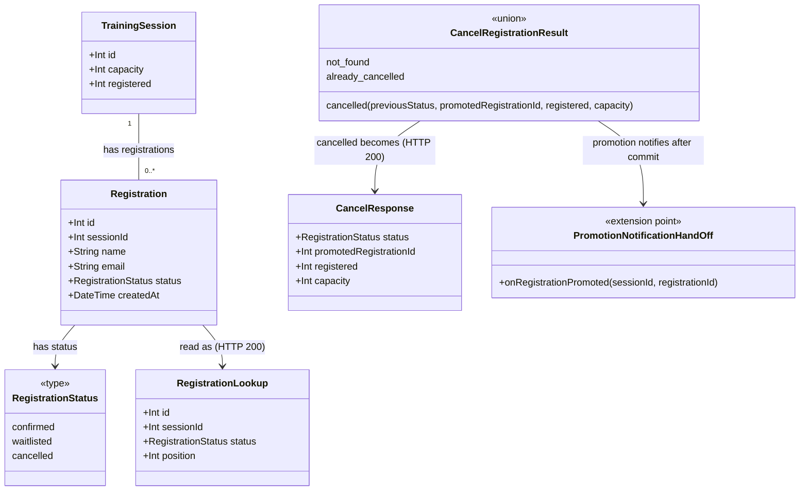

# Promote First Waitlisted Employee After Cancellation

## Requirements

Close the loop between cancellation and the waitlist by giving a freed seat straight to the person who has waited longest, in the same unit of work as the cancellation, so a seat never sits empty or goes to a newcomer while someone is waiting, and so a promoted employee can see on their next visit that they are now confirmed.

Boundaries: automatic promotion of the first waitlisted registration of the same session after a confirmed registration is cancelled. Manual promotion by an organiser, the notification itself and its UI (WH-8), and authentication are excluded. Only a hand-off point for notification is in scope. Registration (LATC-2), waitlist (LATC-3) and cancellation (LATC-4) behaviour stays as it is, except where this canvas states a change.

## Entities

No schema change is needed. A promotion is a status change on an existing waitlisted `Registration` to `confirmed`. `CancelResponse.promotedRegistrationId` is an integer when a promotion happened and `null` otherwise. `RegistrationLookup.position` is present only for a waitlisted registration and is derived from join order, as in LATC-3. It deliberately leaves out name and email.

## Approach

1. Solution Category: Promote inside the cancellation transaction
   - Extend the existing cancellation transaction with a second step: after a confirmed registration has been marked cancelled, look for the first waitlisted registration of the same session and, if there is one, confirm it and keep the seat counted. The cancellation and the promotion commit together or not at all.
   - Net-zero accounting: when a promotion happens the stored `registered` count is not changed (the freed seat is immediately taken). When there is nobody to promote, the count drops by one as in LATC-4.
   - "First" means earliest creation time, with the identifier as tie-break. This matches the join order that the displayed waitlist position already uses.
   - Because the seat is never free between cancellation and promotion, a new registration cannot take it ahead of a waiting employee. This also removes the queue-jumping gap noted in LATC-4.

2. Technical Implementation:
   - Prisma/SQLite: inside the existing cancel transaction, find the first waitlisted registration ordered by creation time then identifier, and move it to `confirmed` with a conditional update that requires it to still be `waitlisted`. If that update changes no row (a competing change got there first), pick the next candidate and repeat until one succeeds or none is left.
   - Only a confirmed cancellation releases a seat or attempts a promotion. Cancelling a waitlisted registration changes nothing else.
   - The post-commit hand-off from LATC-4 (`onSeatFreed`) is replaced by `onRegistrationPromoted(sessionId, registrationId)`, a no-op that WH-8 will use to send a message. It is called after the commit and only when a promotion occurred, so a notification failure can never undo a valid cancellation or promotion.
   - Add a read-only lookup of one registration so a returning employee can see their current status. The page stores the registration id in the browser after a successful registration.
   - Error handling: keep route-level mapping of typed errors. No new error classes are needed; the lookup reuses `RegistrationNotFoundError`.

3. Business Logic:
   - Promote only after a confirmed registration is cancelled. A waitlisted or already cancelled registration never promotes anyone.
   - Never promote a cancelled or already confirmed registration, and never promote a registration of another session.
   - Never promote the same registration twice, even when several cancellations happen at once.
   - The cancel response adds `promotedRegistrationId` (the promoted id, or `null`) to the existing `{ status, registered, capacity }`. The cancelling employee's page ignores the field, so promotion stays invisible to them.
   - Known limitation: because the promoted registration id is also the only proof of ownership for cancelling, returning it hands the canceller the means to cancel that person's registration. The story requires the field, so this is accepted for training and recorded in Safeguards.

## Structure

### Inheritance Relationships

1. `CancelRegistrationResult` stays a discriminated union on `status`, and its `cancelled` member gains `promotedRegistrationId`.
2. `RegistrationLookup` is a plain result type built from a registration.
3. `onRegistrationPromoted` is a plain function in the existing `waitlistPromotion` module, replacing `onSeatFreed`.
4. No new error classes: `RegistrationNotFoundError` and `ValidationError` are reused.

### Dependencies

1. The training-sessions router depends on `cancelRegistration` and `getRegistration` (service) and the existing error classes.
2. `registrationService` depends on `registrationRepository`, `waitlistPromotion` and the error classes.
3. `registrationRepository` depends on the Prisma client only.
4. `TrainingSessionsPage` depends on `TrainingSessionCard` and the shared types, and supplies `onRegister`, `onCancel` and `onLookup`.
5. `TrainingSessionCard` depends on its props and on browser storage, and has no network knowledge.

### Layered Architecture

1. Route layer: parse ids, call the service, map errors to 400, 404 and 409, return 200 for cancel and lookup, and a generic 500 for anything unexpected.
2. Service layer: validate ids, call the repository, convert outcomes, and call the hand-off after the commit when a promotion occurred.
3. Repository layer: own the transaction, the status changes, the promotion choice and the seat accounting.
4. Data layer: existing `Registration` and `TrainingSession` models, unchanged.
5. Error handling: typed errors in `api/src/errors.ts`, mapped at the route.
6. Web layer: page performs the requests and updates counts. Card remembers the registration id in the browser, refreshes its status on load, and renders it.

## Operations

### Update Module - waitlistPromotion

1. Responsibility: the hand-off point for promotion notifications (WH-8).
2. Methods:
   - onRegistrationPromoted(sessionId: number, registrationId: number): Promise<void>
     - Logic:
       - Does nothing for now. A comment states that WH-8 will notify the promoted employee here.
   - Remove `onSeatFreed`, which is replaced by this function.
3. Constraints: no database access and no behaviour until WH-8.

### Update Repository - cancelRegistration

1. Responsibility: cancel, then promote the first waitlisted registration, in one transaction.
2. Methods:
   - cancelRegistration(sessionId: number, registrationId: number): Promise<CancelRegistrationResult>
     - Logic:
       - Keep the existing steps: scoped lookup, `not_found`, `already_cancelled`, and the conditional status update to `cancelled` (zero rows means `already_cancelled`).
       - If the previous status was not `confirmed`, skip promotion and seat release and return the session figures with `promotedRegistrationId: null`.
       - If it was `confirmed`, repeatedly: find the first registration of the session with status `waitlisted`, ordered by `createdAt` ascending then `id` ascending. If none, stop. Otherwise update it to `confirmed` only where its status is still `waitlisted`; if one row changed, record its id as promoted and stop, and if none changed, try the next candidate.
       - If a registration was promoted, do not change `registered`.
       - If nobody was promoted, run the existing conditional decrement (`registered > 0`).
       - Read `registered` and `capacity` for the session and return `{ status: 'cancelled', previousStatus, promotedRegistrationId, registered, capacity }`.
3. Constraints: all steps run inside the same transaction with the existing wait (10 s) and timeout (15 s) limits. `registered` can never exceed `capacity`, and never goes below zero.

### Create Repository Function - getRegistration

1. Responsibility: read one registration for the status lookup.
2. Methods:
   - getRegistration(sessionId: number, registrationId: number): Promise<RegistrationLookupResult>
     - Logic:
       - Find the registration by id and session id. If missing, return `{ status: 'not_found' }`.
       - If its status is `waitlisted`, count the waitlisted registrations of the session with an id less than or equal to this one and return that as `position`.
       - Return `{ status: 'found', registration, position }` with `position` absent unless waitlisted.
3. Constraints: read-only. Position uses the same derivation as the waitlist join in LATC-3.

### Update Service - cancelRegistration and getRegistration

1. Interface Definition:
   - `cancelRegistration(sessionId: number, registrationId: number): Promise<CancelResponse>`
   - `getRegistration(sessionId: number, registrationId: number): Promise<RegistrationLookup>`
2. Core Methods:
   - Input Validation: both ids must be positive whole numbers, otherwise `ValidationError`.
   - Business Logic (cancel): call the repository. If the outcome is `cancelled` and `promotedRegistrationId` is not null, call `onRegistrationPromoted(sessionId, promotedRegistrationId)` after the repository returns.
   - Exception Handling: `not_found` throws `RegistrationNotFoundError`, `already_cancelled` throws `RegistrationAlreadyCancelledError`.
   - Return Value (cancel): `{ status: 'cancelled', promotedRegistrationId, registered, capacity }`, with `promotedRegistrationId` an integer or `null`.
   - Return Value (lookup): `{ id, sessionId, status, position? }`, with no name or email.
3. Dependency Injection: module imports. Extend `CancelResponse` and add `RegistrationLookup` next to the existing result types.
4. Transaction Management: none here.

### Update Route - DELETE and add GET for registrations

1. Responsibility: expose cancel (with the promotion result) and the status lookup.
2. Logic:
   - DELETE `/:id/registrations/:registrationId`: unchanged mapping (400 invalid ids, 404, 409, 500). The 200 body now includes `promotedRegistrationId`.
   - GET `/:id/registrations/:registrationId`: parse both ids (400 `Invalid session ID` or `Invalid registration ID`), call `getRegistration`, return 200 with the lookup body, map `RegistrationNotFoundError` to 404 (same message as cancel) and anything else to a logged 500 `{ error: 'Failed to fetch registration' }`.
3. Constraints: no direct Prisma access in these handlers. Do not touch the `/search` endpoint in the same file.

### Update Types - web

1. Responsibility: type the new fields in `app/src/types/index.ts`.
2. Shapes:
   - `CancelResponse` gains `promotedRegistrationId: number | null`.
   - Add `RegistrationLookup { id: number; sessionId: number; status: RegistrationStatus; position?: number }`.
   - No `any`.

### Update UI - TrainingSessionsPage

1. Responsibility: supply the lookup and keep counts correct.
2. Logic:
   - Add `handleLookup(sessionId: number, registrationId: number): Promise<RegistrationLookup>` that sends a GET to the lookup endpoint. A non-OK response throws an `Error` carrying the body's `error` message, with fallback `Lookup failed: <status>`.
   - `handleCancel` keeps updating the session count from the response. It ignores `promotedRegistrationId`.
   - Pass `onLookup` to each card.

### Update UI - TrainingSessionCard

1. Responsibility: remember the employee's registration across page loads and show its current status.
2. Logic:
   - Add a prop `onLookup(registrationId: number): Promise<RegistrationLookup>`.
   - After a successful registration, store the registration id in browser storage under a key specific to the session (`workshophub.registration.<sessionId>`). Wrap every read and write so a storage failure never breaks the card.
   - On first render, if an id is stored, call `onLookup` and set the remembered registration from the result. If the lookup fails with a not-found error, remove the stored id.
   - Show a status line, `Your registration: Confirmed`, `Your registration: Waitlisted (position N)` or `Your registration: Cancelled`.
   - Keep the LATC-4 behaviour: a Cancel button for a confirmed registration, the confirmation prompt, the success message and the disabled "Cancelled" button.
   - After a cancel, the cancelling employee sees only the existing success message. Promotion is not mentioned.

### Update Tests - promotion coverage (write failing first)

1. Responsibility: cover every acceptance criterion and edge case, and update tests that asserted the LATC-4 shapes.
2. Coverage:
   - Integration: cancelling a confirmed registration with a waitlist promotes the earliest waitlisted registration (its row becomes `confirmed`), `registered` is unchanged, and the response has `promotedRegistrationId` equal to that registration's id.
   - Integration: with an empty waitlist there is no promotion, `registered` drops by one and `promotedRegistrationId` is `null`.
   - Integration: cancelling a waitlisted registration promotes nobody and does not change `registered`.
   - Integration: the next waitlisted registration moves up after a promotion (a later waitlist join gets the right position), and a cancelled waitlisted registration is skipped.
   - Integration: after a promotion, a brand-new registration on the full session is waitlisted, not confirmed.
   - Integration concurrency: several confirmed cancellations on a session with several waitlisted people promote different people, none twice, and `registered` never exceeds `capacity`.
   - Integration: the lookup returns 200 with status (and position when waitlisted) and no name or email, 404 for an unknown or other-session id, and 400 for malformed ids. After a promotion the lookup shows `confirmed`.
   - Unit repository and service: the promotion ordering, the retry when a candidate was already taken, net-zero accounting, `onRegistrationPromoted` called once only after a promotion and never otherwise, and invalid ids rejected. Update or remove the LATC-4 tests that assert `onSeatFreed` and the exact cancel response shape.
   - UI: the card stores the id after registering, looks it up on load, shows Confirmed, Waitlisted with a position, or Cancelled, clears a stale id on not found, tolerates unavailable storage, and shows no promotion message to the canceller. Page tests cover the lookup request and its error handling.
3. Verification: `make test`, `make lint` and `make format-check` pass.

## Norms

1. Typing standards: strict TypeScript, no `any`. Use `unknown` with narrowing and discriminated unions on `status`.
2. Dependency injection: plain module imports. Only the repository touches Prisma. The card receives behaviour through props.
3. Exception handling:
   - Typed errors live in `api/src/errors.ts` and extend `Error`.
   - Expected outcomes cross the repository boundary as union values, and the service converts them to typed errors.
   - The route maps typed errors to `{ error: string }` and logs unexpected errors with a generic 500 body.
4. Data validation: validate ids before any database access.
5. Logging: log only unexpected errors, and never data that identifies a person.
6. Documentation standards: comment only the non-obvious "why" (why promotion runs in the transaction, why the hand-off runs after the commit). Match surrounding comment density.
7. Process: Red-Green-Refactor TDD. Every change passes `make test`, `make lint` and `make format-check`. Never commit secrets or `.env` files.

## Safeguards

1. Functional Constraints: promotion and cancellation commit together or not at all. A confirmed cancellation with a waitlist leaves `registered` unchanged. Without a waitlist it drops by one and never below zero. `registered` never exceeds `capacity`. No registration is promoted twice, and no cancelled registration is promoted.
2. Performance Constraints: cancel plus promotion run in one transaction within the existing 10 s wait and 15 s timeout limits. The lookup is one read plus at most one indexed count.
3. Security Constraints: all SQL uses bound parameters. The lookup never returns name or email. Known limitation: the registration id is a guessable sequential number and the only proof of ownership, and the cancel response returns the promoted registration's id as the story requires, so a canceller can learn the id of the person promoted and could cancel that registration. This is accepted for training and must not be widened. Error messages expose no internal detail. Do not widen the existing raw-SQL search endpoint.
4. Integration Constraints: the cancel response stays a superset of the LATC-4 body, with `promotedRegistrationId` added. The registration, waitlist and cancel status codes and messages are unchanged. Notifications are only a call to `onRegistrationPromoted`, which does nothing until WH-8.
5. Business Rule Constraints: promote only the earliest waitlisted registration of the same session (creation time, then id), only after a confirmed registration is cancelled. A freed seat is never available to a newcomer while someone is waiting. Out of scope and not to be implemented here: organiser promotion, notification delivery and UI, authentication.
6. Exception Handling Constraints:
   - Every expected failure maps to one status: 400 (invalid id), 404 (registration not found, including under another session), 409 (already cancelled).
   - Messages stay `Registration not found` and `Registration is already cancelled`.
   - Typed errors are mapped in the route. Do not introduce a global handler as part of this story.
7. Technical Constraints: no `any`. No direct Prisma in routes or services. `registered` is written only inside repository transactions. No schema change and no new dependencies. Browser storage access is wrapped so its failure never breaks the card.
8. Data Constraints: `status` changes only from `confirmed` or `waitlisted` to `cancelled`, and from `waitlisted` to `confirmed` by promotion. Ids are positive whole numbers. The stored id key is specific to one session.
9. API Constraints: DELETE returns 200 with `{ status: "cancelled", promotedRegistrationId: <id or null>, registered, capacity }`, with 400, 404, 409 and 500 as before. GET `/api/training-sessions/:id/registrations/:registrationId` returns 200 with `{ id, sessionId, status, position? }`, 400 for malformed ids, 404 if missing or under another session, and 500 for unexpected errors. Error bodies are `{ error: string }`.
