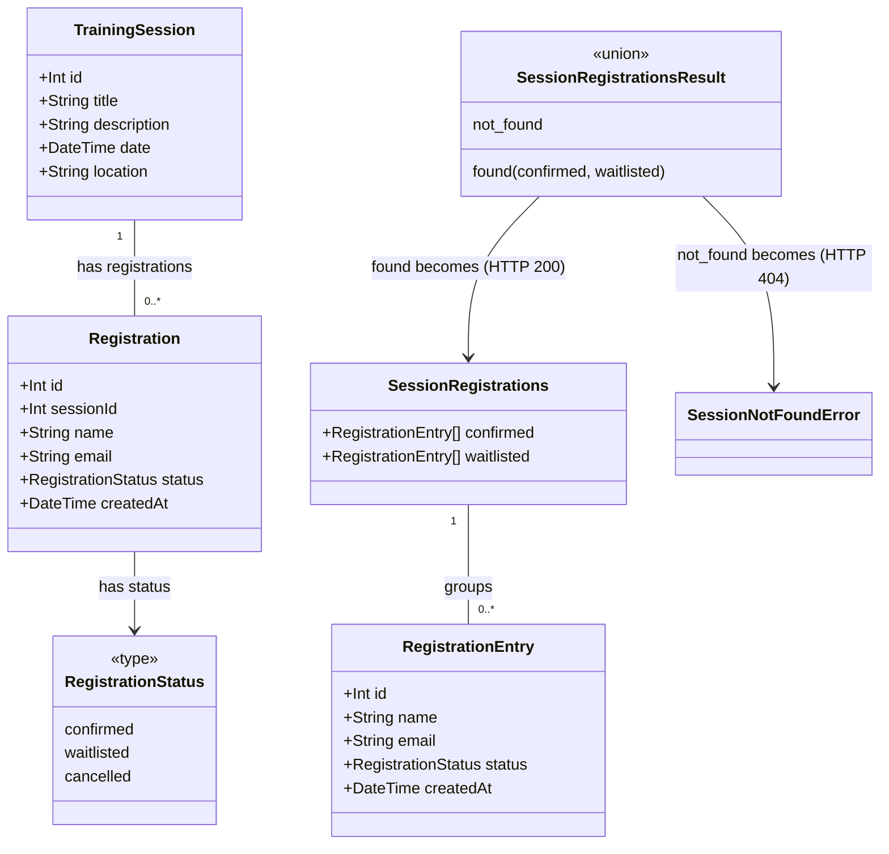

# Organiser Views Registrations For A Session

## Requirements

Let a training organiser see, for any session, who is attending and who is waitlisted, by opening a session detail page that shows the session information and its active registrations (confirmed and waitlisted, cancelled ones hidden), served by a read-only API endpoint.

Boundaries: read-only and open to everyone, with no authentication or roles. CSV export, editing or cancelling from this view, and pagination are excluded. Registration, waitlist, cancellation and promotion behaviour already on `main` (LATC-2 to LATC-5) does not change.

## Entities

No schema change. `RegistrationEntry` is a projection of existing `Registration` fields (id, name, email, status, createdAt); `sessionId` is deliberately left out of the response. `SessionNotFoundError` already exists in `api/src/errors.ts` and is reused. On the web, `SessionRegistrations` and `RegistrationEntry` become TypeScript interfaces in `app/src/types/index.ts`, and the existing `TrainingSession` and `RegistrationStatus` types are reused.

## Approach

1. Solution Category: Read-only roster beside the existing registration endpoints
   - Add `GET /api/training-sessions/:id/registrations` to the same router, using the route → service → repository layering already in place.
   - The repository reads the session and its non-cancelled registrations; the service splits them into `confirmed` and `waitlisted` and returns a result union; the route maps outcomes to HTTP.
   - The response is exactly `{ confirmed: [...], waitlisted: [...] }`. Counts shown in the UI are the array lengths, so no extra fields are added.
   - Each group is ordered by join order (`createdAt` ascending, then `id`), the same order used for waitlist position and promotion, so what the organiser sees matches what employees experience.

2. Technical Implementation:
   - Backend: plain reads with the Prisma client in the repository, no transaction. A view-only page may be momentarily stale, and no data is written. Cancelled rows are excluded in the query itself (`status` in `confirmed`, `waitlisted`), not in the service.
   - The session existence check and the registration read happen in the repository so a non-existent session returns `not_found` (404), never an empty roster.
   - Errors: invalid id → 400 (as the other routes), unknown session → 404, anything else → logged and generic 500. No global handler exists, so mapping stays in the route.
   - Frontend: introduce client-side routing with `react-router-dom` (new dependency, v6). `/` renders the existing sessions page; `/sessions/:id` renders a new `SessionDetailPage`. The server already falls back to `index.html`, and the Vite dev server does so by default, so deep links and refresh work.
   - The detail page loads session info from the existing `GET /api/training-sessions/:id` and the roster from the new endpoint, in parallel, and shows loading, not-found and error states.
   - The session card gets a link on its title to `/sessions/:id`. The whole card is not clickable, so typing in the form and the Register and Cancel buttons never navigate.

3. Business Logic:
   - Cancelled registrations never appear, in API or UI.
   - Confirmed and Waitlist headings show their counts, `Confirmed (N)` and `Waitlist (N)`.
   - When both groups are empty the page shows a single "No registrations yet" message instead of the two sections. When only one group is empty, its heading still shows with `(0)` and a short "None" line.
   - Each entry shows name, email and registration date, formatted like the session date display in the app (`en-SG`).
   - Known trade-off, accepted by the story: the endpoint is public and returns names and emails.

## Structure

### Inheritance Relationships

1. `SessionNotFoundError` extends `Error` and already exists; it is reused unchanged.
2. `SessionRegistrationsResult` is a discriminated union on `status`, like `CancelRegistrationResult`.
3. `RegistrationStatus` already exists in the service module and in the web types and is reused.

### Dependencies

1. The training-sessions router depends on the new `getSessionRegistrations` service function and `SessionNotFoundError`.
2. `registrationService` depends on `registrationRepository` and the error classes.
3. `registrationRepository` depends on the Prisma client only.
4. `main.tsx` wraps `App` in a router; `App` declares the two routes.
5. `SessionDetailPage` depends on the shared types and calls the API through `fetch`, with the same `API_BASE` and error-message pattern as `TrainingSessionsPage`.
6. `TrainingSessionCard` depends on the router's `Link`; existing props are unchanged.

### Layered Architecture

1. Route layer: parse the id (400 when not a whole number), call the service, return 200 with the roster, map `SessionNotFoundError` to 404, and anything else to a logged, generic 500.
2. Service layer: call the repository, convert `not_found` into `SessionNotFoundError`, and return the grouped roster.
3. Repository layer: check the session exists and read its confirmed and waitlisted registrations in join order.
4. Data layer: existing `TrainingSession` and `Registration` models, unchanged. The existing `[sessionId, status]` index serves the query.
5. Error handling: typed errors in `api/src/errors.ts`, mapped at the route.
6. Web layer: router in `App`; `SessionDetailPage` owns fetching and states; a small presentational list renders one group.

## Operations

### Update Repository - listSessionRegistrations

1. Responsibility: read the active registrations of a session.
2. Methods:
   - listSessionRegistrations(sessionId: number): Promise<SessionRegistrationsLookup>
     - Logic:
       - Find the session by id. If it does not exist, return `{ status: 'not_found' }`.
       - Find registrations where `sessionId` matches and `status` is `confirmed` or `waitlisted`, ordered by `createdAt` ascending then `id` ascending.
       - Return `{ status: 'found', registrations }`.
3. Constraints: file `api/src/repositories/registrationRepository.ts`. Read-only, no transaction. Cancelled rows are filtered in the query.

### Update Service - getSessionRegistrations

1. Responsibility: produce the grouped roster for a session.
2. Methods:
   - getSessionRegistrations(sessionId: number): Promise<SessionRegistrations>
     - Input Validation: `sessionId` must be a positive whole number, else throw `ValidationError('Invalid session ID')`.
     - Logic:
       - Call the repository. On `not_found`, throw `SessionNotFoundError`.
       - Split the list into `confirmed` and `waitlisted` by status, keeping the repository order.
       - Map each registration to `{ id, name, email, status, createdAt }` only.
3. Constraints: file `api/src/services/registrationService.ts`. Exports the `RegistrationEntry` and `SessionRegistrations` types. No `any`.

### Update Route - GET /:id/registrations

1. Responsibility: expose the roster over HTTP.
2. Logic:
   - Parse `req.params.id` with `parseInt`; if `NaN`, respond 400 `{ error: 'Invalid session ID' }`.
   - Call `getSessionRegistrations`; respond 200 with the result.
   - `ValidationError` → 400; `SessionNotFoundError` → 404 with its message; anything else → `console.error` and 500 `{ error: 'Failed to fetch session registrations' }`.
3. Constraints: file `api/src/routes/training-sessions.ts`, no Prisma in the handler. The new route is registered alongside the existing `/:id/registrations` POST and must not change or be shadowed by existing routes. Do not touch the `/search` route.

### Update Web Types - session registrations

1. Add `RegistrationEntry` (`id`, `name`, `email`, `status: RegistrationStatus`, `createdAt: string`) and `SessionRegistrations` (`confirmed`, `waitlisted`) to `app/src/types/index.ts`.

### Add Dependency and Routing

1. Add `react-router-dom` (v6, exact current version, pinned) to `app/package.json` dependencies and update the lockfile with `pnpm`.
2. `main.tsx`: wrap `<App />` in `BrowserRouter`.
3. `App.tsx`: keep the header; replace the direct page with `Routes`: `/` → `TrainingSessionsPage`, `/sessions/:id` → `SessionDetailPage`. The header title links back to `/`.
4. Tests render components inside `MemoryRouter`. Existing page and card tests are updated only to add that wrapper.

### Update Component - TrainingSessionCard

1. Wrap the title text in a `Link` to `/sessions/${session.id}` with the same heading element and class. All props, form behaviour and other markup stay as they are.
2. The link text is the session title, so it also works as the accessible name.

### Create Page - SessionDetailPage

1. Responsibility: show one session and its roster.
2. Attributes: `session`, `roster`, `loading`, `error`, and a `notFound` flag in state; id from `useParams`.
3. Logic:
   - On mount (and id change), fetch `/api/training-sessions/:id` and `/api/training-sessions/:id/registrations` in parallel. Ignore results after unmount.
   - A 404 from either call shows "Training session not found" with a link back to the list. A non-OK status shows "Failed to load session" with the detail, as the list page does.
   - Header: title, date and time, location, description (the same date formatting as the card), and a "Back to sessions" link.
   - "Registrations" section: when both arrays are empty, show "No registrations yet". Otherwise show `Confirmed (N)` and `Waitlist (N)` subsections; each entry lists name, email and registration date; an empty subsection shows "None".
4. Constraints: file `app/src/pages/SessionDetailPage.tsx` plus its CSS file. No cancel, edit or export controls. No `any`.

### Tests (Red phase first, per TDD)

1. API unit, repository: returns `not_found` for an unknown session; excludes cancelled; orders by `createdAt` then `id`.
2. API unit, service: groups into the two arrays; maps only the five fields; throws `SessionNotFoundError` for `not_found`; rejects an invalid id.
3. API integration: 200 with both arrays for `/api/training-sessions/:id/registrations`; cancelled not present; 404 for an unknown session; 400 for a non-numeric id; response fields include `id`, `name`, `email`, `status`, `createdAt`; confirmed and waitlisted arrays empty for a session with none.
4. Web, `SessionDetailPage`: shows session info and both subsections with counts; entries show name, email and date; "No registrations yet" when both empty; not-found and error states; no login required.
5. Web, `TrainingSessionCard`: the title links to `/sessions/:id`; existing register and cancel tests still pass.

## Norms

1. Annotation Standards: no decorators in this stack. Use TypeScript types and interfaces; discriminated unions for repository results; React function components with default exports.
2. Dependency Injection: modules import their collaborators directly (route → service → repository → Prisma client). The web page takes the API base from `import.meta.env.VITE_API_URL`, as the existing page does.
3. Exception Handling:
   - Typed errors live in `api/src/errors.ts`, extend `Error` and set `name`.
   - Mapping to HTTP happens in the route: 400 validation, 404 not found, generic 500 with `console.error` for the rest.
   - Error bodies use `{ error: string }`. The web reads them with the existing `errorMessageFrom` approach.
4. Data Validation: ids are whole numbers; the service checks as well as the route.
5. Logging: `console.error` for unexpected failures only, with the same wording style as existing routes.
6. Documentation Standards: short comments only where the reason is not obvious (e.g. why ordering matches promotion order). Match the surrounding code's comment density. Prettier and ESLint rules apply to all new code.
7. Testing: Red-Green-Refactor. Unit tests for repository and service in `api/tests/unit`, integration in `api/tests/integration`, component tests beside the components in `app/src`. No `any`.

## Safeguards

1. Functional Constraints: only `confirmed` and `waitlisted` registrations are returned; a session with none returns `{ confirmed: [], waitlisted: [] }` with 200; the endpoint never writes.
2. Performance Constraints: one session lookup and one registration query per request, using the `[sessionId, status]` index. No pagination (out of scope), so the response is unbounded, which is acceptable at training scale.
3. Security Constraints: the endpoint and page are public by design. Return only `id`, `name`, `email`, `status`, `createdAt`; never `sessionId` or internals. Use Prisma's typed queries only (no raw SQL, and do not copy the `/search` pattern). Do not read or touch `.env` files.
4. Integration Constraints: existing endpoints, response shapes and tests must stay unchanged; existing card and page tests keep passing after the router wrapper is added. Registration and cancellation flows are not altered.
5. Business Rule Constraints: cancelled registrations are never shown; waitlist and confirmed order is join order; counts equal the array lengths; "No registrations yet" appears only when both groups are empty.
6. Exception Handling Constraints:
   - Unknown session → 404 `Training session not found`; non-numeric id → 400 `Invalid session ID`.
   - 500 responses use a generic message and never include stack traces or database details.
7. Technical Constraints: no `any`; no Prisma access in routes or components; `react-router-dom` is the only new dependency and needs team acceptance; no changes to `prisma/schema.prisma`; `make test` and `make lint` must pass.
8. Data Constraints: dates are returned as ISO strings (Prisma/JSON default) and formatted only in the UI; names and emails are shown as stored, and React's escaping covers rendering.
9. API Constraints: `GET /api/training-sessions/:id/registrations` → 200 `{ confirmed: RegistrationEntry[], waitlisted: RegistrationEntry[] }`, 400 invalid id, 404 unknown session, 500 on unexpected failure. The web route is `/sessions/:id`.
