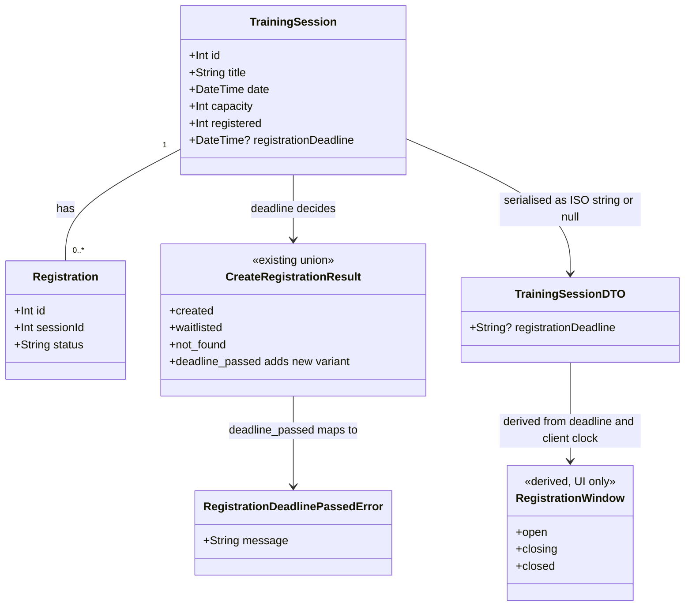

# Registration Deadline Blocks Late Registration

## Requirements

Let a training session carry an optional registration cutoff so that organisers get a predictable preparation window: once the server clock passes the deadline, nobody can register (confirmed or waitlisted), and the session card tells employees clearly whether registration is open, closing at a given time, or closed.

Boundaries: one nullable `registrationDeadline` instant on `TrainingSession`; a server-side rejection (HTTP 422, `{ error: "Registration deadline has passed" }`) enforced atomically before any seat is claimed; deadline exposure through the existing session read endpoints; a UI label, a closed state, and an inline late-submit error on the session card. Sessions without a deadline behave exactly as today. Out of scope: organiser UI for setting the deadline (seed data only), automatic session status change at the deadline, timezone handling beyond UTC, and any change to cancellation or waitlist promotion (neither is a new registration, so the deadline does not gate them). Existing registration (LATC-2), waitlist (LATC-3), cancel (LATC-4), promotion (LATC-5), roster (LATC-6) and notification (LATC-8) behaviour and contracts are unchanged.

## Entities

Notes:

- `registrationDeadline` is the only schema change: a nullable `DateTime` column. Existing rows get `null`, which never blocks.
- `RegistrationWindow` is never stored or returned by the API. It is computed in the UI from the deadline and the browser clock, for display only.
- `RegistrationDeadlinePassedError` is a new domain error next to the existing ones in `api/src/errors.ts`.
- Registration response shapes (`RegistrationResult`, `WaitlistResult`, `CancelResponse`) are unchanged.

## Approach

1. Data and enforcement:
   - Add `registrationDeadline DateTime?` to the Prisma model, applied with `prisma db push` as in `make setup`.
   - The rule (reject when `now > deadline`, with a null deadline never blocking) is enforced inside the same repository transaction that claims the seat. The transaction first reads the session, so the check and the seat claim are atomic with respect to the cutoff and a rejected request never consumes a seat or creates a row.
   - The repository returns a distinct `deadline_passed` result. The service translates it to `RegistrationDeadlinePassedError`. The route maps it to HTTP 422. This keeps Prisma out of routes and mirrors how `not_found` is handled today.
   - The clock is the server's `new Date()` read inside the repository, never anything from the request. Tests control it with Jest fake timers.
   - Boundary: closed only when `now` is strictly after the deadline, so a deadline equal to now is still open.
   - The deadline gates the waitlist too, because joining the waitlist is a registration (a full session whose deadline passed rejects with 422, not 202).

2. Technical implementation:
   - Input validation (400) still runs first in the service, before any database access, so an invalid body on a closed session returns 400. An unknown session returns 404 before the deadline is considered.
   - Existing read endpoints (`GET /api/training-sessions`, `GET /:id`) already return the full row, so the deadline appears as an ISO string or `null` with no code change. The `/search` raw query also returns the column unchanged.
   - Frontend: add `registrationDeadline: string | null` to the `TrainingSession` type. The card derives the window state from the deadline and `Date.now()`.
   - Error mapping: the API message ("Registration deadline has passed") differs from the required UI text, so the card maps the late-submit failure to "Registration for this session has closed". The client signals this by throwing a typed error carrying the HTTP status, and the card checks for status 422.

3. Business logic and UI behaviour:
   - Open with a future deadline: show "Registration closes: {formatted date and time}" directly above the form button. No deadline: no label.
   - Closed (deadline passed by the browser clock): replace the form and its Register / Join Waitlist button with the text "Registration closed". The closed text takes precedence over the full-session waitlist hint.
   - A visitor who already holds a registration (confirmed, waitlisted or cancelled) still sees their status line and, if confirmed, the Cancel Registration button on a closed session. Only the new-registration form is replaced.
   - Late submit (page opened before the cutoff): the 422 shows the inline error "Registration for this session has closed", and the card then switches to the closed state so the form is gone.
   - The server stays authoritative. Client clock skew can only cause a mismatch in the display, never in the enforcement.

## Structure

### Inheritance Relationships

1. `RegistrationDeadlinePassedError` extends `Error`, in `api/src/errors.ts`, alongside `ValidationError` and `SessionNotFoundError`.
2. `CreateRegistrationResult` gains a `{ status: 'deadline_passed' }` variant. No new classes or interfaces besides the error.

### Dependencies

1. `registrationRepository.claimSeatAndRegister` reads the session (deadline) before the conditional UPDATE and returns `deadline_passed` when closed.
2. `registrationService.registerForSession` depends on the new result variant and throws `RegistrationDeadlinePassedError`.
3. `routes/training-sessions.ts` POST handler imports the error and maps it to 422.
4. `TrainingSessionCard` depends on the `TrainingSession.registrationDeadline` field and on the status carried by the API client error.
5. The seed script depends only on the Prisma client.

### Layered Architecture

1. Route layer: add one `instanceof RegistrationDeadlinePassedError` branch returning 422. No Prisma, no deadline logic.
2. Service layer: translate the repository result into a domain error. No clock access.
3. Repository layer: the only place that reads the clock and the deadline, and the only place that touches Prisma.
4. Data layer: nullable `registration_deadline`-equivalent column via the Prisma model (`registrationDeadline`) on `training_sessions`.
5. Frontend: `TrainingSessionCard` owns the derived window state and the late-submit message. `TrainingSessionsPage` and `SessionDetailPage` only pass the session through.
6. Error handling: domain error to HTTP mapping stays in the route. The unexpected-error 500 path is unchanged.

## Operations

Follow Red-Green-Refactor for every item: write the failing test first, then the minimal code, then refactor. Execute in the order listed.

### Update Schema - TrainingSession (`api/prisma/schema.prisma`)

1. Responsibility: store the optional deadline.
2. Attributes:
   - `registrationDeadline`: `DateTime?` - null means registration is never restricted.
3. Steps: add the field after `date`, run `pnpm exec prisma generate` and `prisma db push` (via the `api` package scripts) so the client types include it.
4. Constraints: no data migration needed, existing rows become null. Do not touch `.env` files.

### Create Business Exception - RegistrationDeadlinePassedError (`api/src/errors.ts`)

1. Inheritance: extends `Error`, following the existing pattern.
2. Attributes: `message` fixed to `Registration deadline has passed`, `name` set to `RegistrationDeadlinePassedError`.
3. Constructors: no arguments.
4. Usage Scenarios: thrown by `registerForSession` when the repository returns `deadline_passed`.

### Update Repository - createRegistration (`api/src/repositories/registrationRepository.ts`)

1. Responsibility: reject registrations after the deadline atomically with seat claiming.
2. Changes:
   - Extend `CreateRegistrationResult` with `| { status: 'deadline_passed' }`.
   - At the top of `claimSeatAndRegister`, before the conditional UPDATE: `const gate = await tx.trainingSession.findUnique({ where: { id: sessionId }, select: { registrationDeadline: true } })`.
   - If `gate` is null, return `{ status: 'not_found' }`.
   - If `gate.registrationDeadline !== null && new Date() > gate.registrationDeadline`, return `{ status: 'deadline_passed' }` without writing anything.
   - Otherwise continue with the existing logic unchanged (the later `not_found` branch stays as a defensive path).
3. Constraints: strictly greater-than comparison. Still one transaction, same conditional UPDATE, so `registered` can never exceed `capacity`. No `any`.
4. Tests (`api/tests/unit/registrationRepository.test.ts`): update the mocked transaction to answer the new `findUnique` call; add cases for future deadline (proceeds), past deadline (returns `deadline_passed`, `$executeRaw` and `registration.create` not called), null deadline (proceeds), deadline equal to now (proceeds), unknown session (`not_found`), and a full session past its deadline (`deadline_passed`, not waitlisted). Use `jest.useFakeTimers().setSystemTime(...)`.

### Update Service - registerForSession (`api/src/services/registrationService.ts`)

1. Responsibility: map the new result to a domain error.
2. Changes: add `case 'deadline_passed': throw new RegistrationDeadlinePassedError()` to the switch, importing the error.
3. Constraints: validation still runs first via `parseInput`. No notification is sent for the rejected request.
4. Tests (`api/tests/unit/registrationService.test.ts`): `deadline_passed` from the repository rejects with `RegistrationDeadlinePassedError` and `notifyRegistration` is not called; an invalid body with a mocked `deadline_passed` still rejects with `ValidationError` and the repository is not called.

### Update Route - POST /:id/registrations (`api/src/routes/training-sessions.ts`)

1. Responsibility: expose the 422.
2. Changes: import `RegistrationDeadlinePassedError`; in the catch block add `if (error instanceof RegistrationDeadlinePassedError) { res.status(422).json({ error: error.message }); return }` before the 500 fallback.
3. Constraints: body shape `{ error: "Registration deadline has passed" }`, same shape as the other errors.
4. Tests (`api/tests/integration/registrations.test.ts`, following the existing setup): register before deadline gives 201; after deadline gives 422 with the exact body and the session's `registered` count and registration rows unchanged; no deadline gives 201; a full session past its deadline gives 422 (not 202); the listing `GET /api/training-sessions` includes `registrationDeadline` as an ISO string when set and `null` otherwise.

### Update Seed Data (`api/prisma/seed.ts`)

1. Responsibility: give the UI and manual testing sessions in each deadline state.
2. Changes: compute `const now = Date.now()` and set `registrationDeadline` on the existing five sessions: session 1 `new Date(now + 30 * DAY_MS)` (open), session 2 `new Date(now - 1 * DAY_MS)` (closed), sessions 3 to 5 left unset (null).
3. Constraints: define `DAY_MS` as a named constant. Keep titles, dates and capacities unchanged so existing tests that depend on the seed do not break.

### Update Types (`app/src/types/index.ts`)

1. Add `registrationDeadline: string | null` to `TrainingSession`.
2. Update every existing UI test fixture that builds a `TrainingSession` to include `registrationDeadline: null`.

### Update API client error status (`app/src/pages/TrainingSessionsPage.tsx`, `app/src/types/index.ts`)

1. Responsibility: let the card recognise a deadline rejection without parsing text.
2. Changes: `ApiError extends Error` with `readonly status: number` is exported from `app/src/types/index.ts`; the register request in `TrainingSessionsPage.tsx` throws `new ApiError(message, res.status)` on a non-ok response, keeping `message` as the server message. `TrainingSessionCard` imports `ApiError` from `../types`. All other callers keep working because `ApiError` is an `Error`.
3. Tests (`TrainingSessionsPage.test.tsx`): a 422 response shows the alert "Registration for this session has closed", then "Registration closed", with no Register button.

### Update Component - TrainingSessionCard (`app/src/components/TrainingSessionCard.tsx`)

1. Responsibility: show the deadline label, the closed state and the late-submit error.
2. Attributes (derived, not state unless noted):
   - `deadlineMs`: `session.registrationDeadline ? new Date(session.registrationDeadline).getTime() : null`.
   - `isClosedByClock`: `deadlineMs !== null && Date.now() > deadlineMs`.
   - `closedByServer`: `useState<boolean>(false)`, set when a submit fails with status 422.
   - `registrationClosed`: `isClosedByClock || closedByServer`.
3. Methods and rendering:
   - `formatDeadline(dateStr: string): string`: `toLocaleString('en-SG', { dateStyle: 'long', timeStyle: 'short' })`, in the same locale as the other date helpers.
   - In `handleSubmit`'s catch: if `err instanceof ApiError && err.status === 422`, call `setClosedByServer(true)` and `setErrorMessage('Registration for this session has closed')`; otherwise keep the existing message handling.
   - Rendering: when `registrationClosed`, do not render the form inputs or the Register / Join Waitlist button; render `
Registration closed
` in their place. Keep the existing registration status line, Cancel Registration button, cancelled button, success message and error message, so a holder of a registration still sees them (implemented by keeping the `form` element and conditionally rendering only the hint, inputs, deadline label and submit button; the closed paragraph replaces them).
   - When open and `deadlineMs !== null`, render `
Registration closes: {formatDeadline(session.registrationDeadline)}
` directly above the submit button.
   - When `registrationClosed`, suppress the "This session is full" hint.
4. Annotations: none. Add small styles for the two new classes in `TrainingSessionCard.css`, reusing existing tokens.
5. Constraints: no `any`. Without a deadline, markup is identical to today. Storage handling is untouched.
6. Tests (`TrainingSessionCard.test.tsx`, use `vi.useFakeTimers` / `setSystemTime` per the existing test tooling): future deadline shows "Registration closes:" and the Register button; past deadline shows "Registration closed" and no Register button or name/email inputs; null deadline shows neither label nor closed text and Register works; submit rejecting with `ApiError` status 422 shows "Registration for this session has closed" and then "Registration closed" with no form button; closed session with a stored confirmed registration still shows the status line and Cancel button; closed full session shows "Registration closed" and not the waitlist hint; a non-422 failure keeps its own message and the form.

## Norms

1. Annotation Standards: TypeScript only, no decorators. Express routes stay thin handlers wrapped in try/catch like the existing ones.
2. Dependency Injection: plain module imports, as in the existing services. Tests use `jest.mock` for repositories and notifiers, and Vitest utilities for the UI.
3. Exception Handling:
   - Domain errors extend `Error`, set `name`, and live in `api/src/errors.ts`.
   - Mapping to HTTP status happens only in routes. Error body is always `{ error: string }`.
   - Unexpected errors are logged with `console.error` and answered with the generic 500 body, never leaking internals.
4. Data Validation: input validation stays in `parseInput` and runs before any database access. The deadline is a server-stored value, never accepted from the request body.
5. Logging: no new logging on the happy path. Do not log request bodies or emails for the rejection.
6. Documentation Standards: a short comment on the deadline check explaining why it is inside the transaction and why the comparison is strict. No `any`; use `unknown` with narrowing. Follow Prettier and ESLint config; `make lint` and `make test` must pass.

## Safeguards

1. Functional Constraints: registration (including waitlist joining) is rejected iff `registrationDeadline` is non-null and server `now` is strictly after it. A rejected request creates no registration row, does not change `registered`, and sends no notification.
2. Performance Constraints: the registration path adds exactly one indexed primary-key read inside the existing transaction. No additional queries on read endpoints.
3. Security Constraints: the deadline decision uses server time only. The request cannot supply or override the deadline or the time. No `.env` or secrets are read, edited or committed.
4. Integration Constraints: existing contracts are unchanged: 201 for confirmed, 202 for waitlisted, 400 for invalid input, 404 for unknown session, 500 for unexpected errors. The only new outcome is 422. LATC-8 notifications and LATC-5 promotion are unaffected.
5. Business Rule Constraints: a null deadline never blocks. A deadline equal to now is open. Cancellation and waitlist promotion are never blocked by the deadline. A full session past its deadline answers 422, not 202.
6. Exception Handling Constraints:
   - The 422 body is exactly `{ "error": "Registration deadline has passed" }`.
   - The error is classified as a registration-domain error, mapped in the route.
   - No stack traces or internal details in the response.
7. Technical Constraints: no `any`. No direct Prisma access in routes or components. The check must stay inside the seat-claiming transaction. Do not bypass git hooks, do not push, and follow Red-Green-Refactor.
8. Data Constraints: `registrationDeadline` is nullable `DateTime`, serialised as an ISO 8601 UTC string or `null`. The frontend type is `string | null`. No validation that the deadline precedes the session date (no organiser UI exists).
9. API Constraints: `POST /api/training-sessions/:id/registrations` keeps its path and request body. The UI text "Registration for this session has closed" is a client-side mapping and is never returned by the API. Out-of-scope items (organiser UI, automatic status change, timezone handling) must not be implemented.
