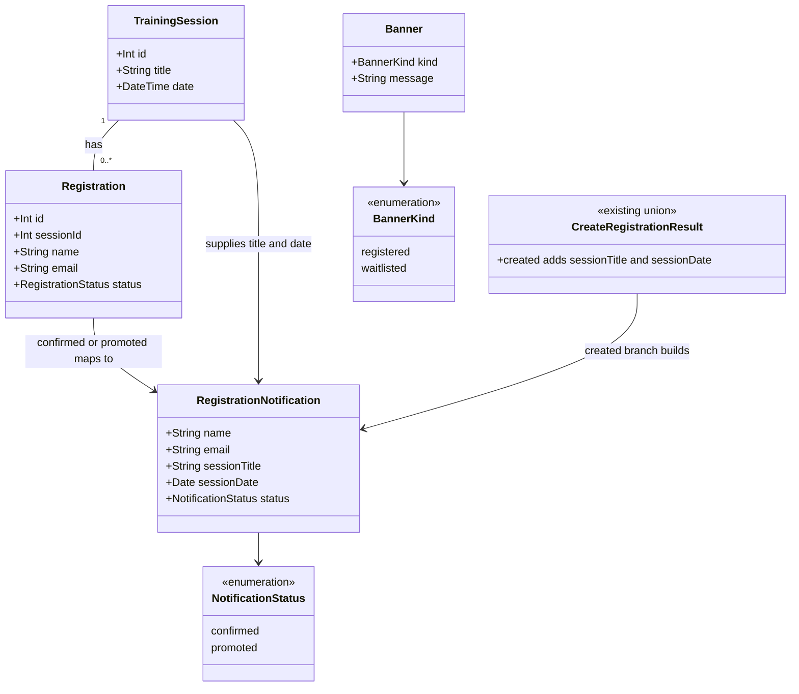

# Notify Employees After Registration or Waitlist Promotion

## Requirements

Give employees immediate, trustworthy confirmation that their seat is secured, or that they are queued, without having to check back: an in-app banner right after they submit the registration form, plus a best-effort server-side notification whenever an employee becomes confirmed, either directly or by promotion from the waitlist.

Boundaries: a page-level banner on the sessions page for the confirmed and waitlisted outcomes. A backend notification event (console log, plus Slack when `SLACK_WEBHOOK_URL` is set) for the `confirmed` and `promoted` outcomes only. Notification delivery never affects registration, promotion, or the banner. Out of scope: real email, SMS, cancellation notifications, notification history or inbox, and any schema change. Registration (LATC-2), waitlist (LATC-3), cancellation (LATC-4) and promotion (LATC-5) keep their behaviour and API contracts, except where this canvas states a change.

## Entities

Notes:
- `RegistrationNotification` and `NotificationStatus` are in-memory only. They are never persisted, and there is no schema change.
- `promoted` is a notification label only. The stored registration status for a promoted employee stays `confirmed`.
- The registration API response shapes (`RegistrationResult`, `WaitlistResult`, `CancelResponse`) are unchanged. The extra session fields on the repository result are internal and are not copied into the HTTP response.

## Approach

1. Notification delivery:
   - A single non-awaited entry point, `notifyRegistration`, owns delivery. It builds nothing itself and takes a ready `RegistrationNotification`.
   - It always logs one line to the console. When `SLACK_WEBHOOK_URL` is set it additionally posts one plain-text message to Slack.
   - Every failure (synchronous throw, rejected promise, non-2xx, timeout) is caught and logged inside the notifier. Nothing propagates to callers, so no unhandled rejection is possible.
   - A plain function is chosen over an event emitter: two producers and two channels do not justify a bus, and the single entry point leaves room for one later.

2. Trigger points (service layer, after commit):
   - Confirmed registration: `registerForSession` notifies after `createRegistration` returns the `created` branch. The transaction has already committed, so a seat is never announced before it is durable. Waitlisted outcomes send no backend notification.
   - Promotion: `onRegistrationPromoted` (the LATC-5 hand-off, called after the cancel transaction commits) loads the promoted registration with its session and notifies with status `promoted`. It receives only ids, so it needs one extra read.
   - The cancel service stops awaiting the hand-off, because awaiting a database read plus Slack would add latency to the cancel response. The hand-off swallows its own errors.
   - Session title and date for the confirmed case come from the transaction that already reads the session, which avoids a second query.

3. In-app feedback:
   - A page-level `Banner` on `TrainingSessionsPage`, driven by the resolved value of the existing `handleRegister`. It depends on the register response only, never on notification delivery.
   - Confirmed: `You're registered! {title} on {formatted date}`. Waitlisted: `You're on the waitlist for {title}. We'll let you know if a spot opens up.`
   - Dismissible with a button, and auto-dismisses after `BANNER_AUTO_DISMISS_MS` (5000). A newer banner replaces the older one and resets the timer. The timer is cleared on replace, dismiss and unmount.
   - The banner replaces the card's inline success message for register and join-waitlist, so there is one success message per action. Inline errors, the status line, and the cancel confirmation message are unchanged.

4. Error handling and privacy:
   - No new HTTP errors, because notification never reaches the request path. Existing `ValidationError` and `SessionNotFoundError` handling is untouched.
   - The webhook URL is read only from the environment, never logged, never committed.
   - Logs contain name and email as the story requires, and the Slack text carries the same fields.

## Structure

### Inheritance Relationships
1. `RegistrationNotification` is a plain TypeScript interface, and `NotificationStatus` is a string-literal union (`'confirmed' | 'promoted'`).
2. No new classes or error types. Existing `ValidationError` and `SessionNotFoundError` are untouched.

### Dependencies
1. `registrationService.registerForSession` calls `notificationService.notifyRegistration`.
2. `waitlistPromotion.onRegistrationPromoted` calls `registrationRepository.findRegistrationWithSession` and `notificationService.notifyRegistration`.
3. `registrationService.cancelRegistration` calls `onRegistrationPromoted` without awaiting it.
4. `registrationRepository.createRegistration` additionally returns the session title and date on the `created` branch.
5. `notificationService` depends only on `console` and the runtime `fetch`. It has no dependency on Prisma or on routes.
6. `TrainingSessionsPage` renders `Banner` and calls the existing `TrainingSessionCard`, whose `onRegister` still resolves with the registration.

### Layered Architecture
1. Route layer (`routes/training-sessions.ts`): no change. Routes stay free of Prisma and of notification logic.
2. Service layer: `registrationService` decides when to notify. `waitlistPromotion` owns the promotion hand-off. `notificationService` owns delivery and failure containment.
3. Repository layer: `registrationRepository` is the only place that touches Prisma, including the new post-commit read for the promoted registration.
4. Frontend: `TrainingSessionsPage` owns banner state and timing. `Banner` is presentational. `TrainingSessionCard` reports outcomes and no longer renders the register/waitlist success text.
5. Error handling: the notifier is the failure boundary. The existing route-level catch and the Express error middleware are unchanged.

## Operations

### Create Service - notificationService (`api/src/services/notificationService.ts`)
1. Responsibility: deliver a registration notification best-effort, never throwing and never blocking.
2. Types:
   - `export type NotificationStatus = 'confirmed' | 'promoted'`
   - `export interface RegistrationNotification { name: string; email: string; sessionTitle: string; sessionDate: Date; status: NotificationStatus }`
3. Constants: `SLACK_TIMEOUT_MS = 5000`.
4. Methods:
   - `formatNotification(notification: RegistrationNotification): string`
     - Logic: return one plain-text line containing status, name, email, session title and the session date as an ISO string, e.g. `[notification] confirmed: Ada Lovelace <ada@example.com> - "Intro to TDD" on 2026-12-01T09:00:00.000Z`.
   - `notifyRegistration(notification: RegistrationNotification): void`
     - Logic:
       - Wrap everything in a try/catch. On a synchronous error, log `Notification failed` with the error and return.
       - Start `deliver(notification)` without awaiting it, and attach `.catch` that logs `Notification failed` with the error.
       - Return `undefined` immediately.
   - `deliver(notification: RegistrationNotification): Promise<void>` (module-private)
     - Logic:
       - `console.log(formatNotification(notification))`.
       - Read `process.env.SLACK_WEBHOOK_URL` at call time. If unset or empty, return.
       - POST JSON `{ text: formatNotification(notification) }` with header `Content-Type: application/json` and `signal: AbortSignal.timeout(SLACK_TIMEOUT_MS)`.
       - If the response is not ok, throw an `Error` with the status code only. Never include the URL in the message.
5. Constraints: no `any`. Errors are typed `unknown` and narrowed before logging. The webhook URL is never logged.

### Update Repository - createRegistration (`api/src/repositories/registrationRepository.ts`)
1. Responsibility: also return the session title and date for a confirmed registration.
2. Changes:
   - Extend the `created` variant of `CreateRegistrationResult` with `sessionTitle: string` and `sessionDate: Date`.
   - In `claimSeatAndRegister`, extend the existing post-create session select to `{ registered, capacity, title, date }`, and return the two new fields on the `created` result.
   - The `waitlisted` and `not_found` variants are unchanged.
3. Constraints: still one transaction, same conditional UPDATE. No extra queries on the registration path.

### Create Repository Function - findRegistrationWithSession (`api/src/repositories/registrationRepository.ts`)
1. Responsibility: load one registration with its session for post-commit use.
2. Signature: `findRegistrationWithSession(registrationId: number): Promise<(Registration & { session: TrainingSession }) | null>` using `prisma.registration.findUnique({ where: { id }, include: { session: true } })`.
3. Constraints: read-only. Import `TrainingSession` from `@prisma/client`.

### Update Service - registerForSession (`api/src/services/registrationService.ts`)
1. Responsibility: notify after a confirmed registration.
2. Logic:
   - In the `created` case, after building the return value, call `notifyRegistration({ name: result.registration.name, email: result.registration.email, sessionTitle: result.sessionTitle, sessionDate: result.sessionDate, status: 'confirmed' })`, then return as before.
   - The `waitlisted` and `not_found` cases are untouched, with no notification for either.
3. Constraints: the returned object must be identical to today's. `notifyRegistration` is not awaited and cannot throw.

### Update Service - onRegistrationPromoted (`api/src/services/waitlistPromotion.ts`)
1. Responsibility: notify the promoted employee. Replaces the empty LATC-5 hand-off body.
2. Signature stays `(sessionId: number, registrationId: number): Promise<void>`. Remove the stale comment that points at WH-8.
3. Logic:
   - Wrap the whole body in try/catch. On any error, log `Promotion notification failed` and return normally.
   - Call `findRegistrationWithSession(registrationId)`. If it returns null, or `registration.sessionId !== sessionId`, or `registration.status !== 'confirmed'`, return silently.
   - Otherwise call `notifyRegistration({ name, email, sessionTitle: session.title, sessionDate: session.date, status: 'promoted' })`.
4. Constraints: this function must never reject.

### Update Service - cancelRegistration (`api/src/services/registrationService.ts`)
1. Responsibility: stop the cancel response from waiting on notification work.
2. Logic: replace `await onRegistrationPromoted(sessionId, result.promotedRegistrationId)` with `void onRegistrationPromoted(sessionId, result.promotedRegistrationId)`. Keep it after the commit, and keep the response body as it is.
3. Constraints: the promoted-registration check (`!== null`) stays. Because `onRegistrationPromoted` never rejects, no unhandled rejection is possible.

### Create Component - Banner (`app/src/components/Banner.tsx`, `Banner.css`)
1. Responsibility: show one dismissible, accessible message.
2. Props: `kind: 'registered' | 'waitlisted'`, `message: string`, `onDismiss: () => void`.
3. Render: a container with `role="status"` and class `banner banner--{kind}`, the message text, and a button labelled `Dismiss` (`aria-label="Dismiss notification"`) that calls `onDismiss`.
4. Style: success tone for `registered`, informational tone for `waitlisted`, consistent with the existing page CSS tokens.
5. Constraints: presentational only, with no timers and no state.

### Update Page - TrainingSessionsPage (`app/src/pages/TrainingSessionsPage.tsx`)
1. Responsibility: own banner state and timing.
2. Changes:
   - Add `const BANNER_AUTO_DISMISS_MS = 5000`.
   - Add state `banner: { id: number; kind: 'registered' | 'waitlisted'; message: string } | null`, and a counter ref for the id.
   - Add `formatBannerDate(dateStr: string): string` using `toLocaleDateString('en-SG', { weekday: 'long', year: 'numeric', month: 'long', day: 'numeric' })`, matching the card's existing date format.
   - In `handleRegister`, after the response is processed and the session counts updated, find the session by id and set the banner:
     - `confirmed` becomes `You're registered! ${title} on ${formattedDate}`.
     - `waitlisted` becomes `You're on the waitlist for ${title}. We'll let you know if a spot opens up.`
   - Add an effect keyed on `banner?.id` that starts a `setTimeout(() => setBanner(null), BANNER_AUTO_DISMISS_MS)` and clears it in the cleanup.
   - Render `<Banner>` above the session list when `banner` is set, with `onDismiss={() => setBanner(null)}`.
3. Constraints: on a failed registration, no banner is set, and the thrown error still reaches the card's inline error. The existing return value of `handleRegister` is unchanged.

### Update Component - TrainingSessionCard (`app/src/components/TrainingSessionCard.tsx`)
1. Responsibility: stop duplicating the success message now shown by the banner.
2. Changes: in `handleSubmit`, remove the `setConfirmation(...)` call for registered and waitlisted outcomes. Keep `setRegistration`, `setPosition`, `storeId`, and the form reset. The cancel flow's `setConfirmation('Your registration has been cancelled')` and all error handling remain.
3. Constraints: the persistent status line (`statusLine`) still shows Confirmed or Waitlisted with position.

### Document Configuration
1. Add `SLACK_WEBHOOK_URL` (optional, empty by default) as a commented entry in the repository's `.env.example` if one exists, otherwise in the README environment section. Do not touch any real `.env` file.

### Tests (Red phase first, per TDD)
1. `api/tests/unit/notificationService.test.ts`:
   - Logs a line with name, email, title, date and status for `confirmed` and `promoted`.
   - With `SLACK_WEBHOOK_URL` unset, `fetch` is not called.
   - With it set, `fetch` is called once with the URL and a JSON body containing the message.
   - A throwing `console.log`, a rejected `fetch`, and a non-ok response never throw or reject, and the failure is logged.
   - `notifyRegistration` returns synchronously before a slow `fetch` resolves.
   - The webhook URL never appears in logged output.
2. `api/tests/unit/registrationService.test.ts` (update):
   - A `created` result triggers one `confirmed` notification with the right fields.
   - A `waitlisted` result triggers none. `not_found` triggers none.
   - A throwing notifier does not change the returned registration.
3. `api/tests/unit/registrationService.cancel.test.ts` (update):
   - The cancel response is returned without waiting for a slow hand-off.
   - No hand-off call when nothing was promoted.
4. `api/tests/unit/waitlistPromotion.test.ts` (new):
   - A confirmed promoted registration yields one `promoted` notification with the session details.
   - Missing registration, mismatched session, or non-confirmed status sends nothing.
   - A repository error is swallowed and the function resolves.
5. `api/tests/unit/registrationRepository.test.ts` (update): the `created` result includes `sessionTitle` and `sessionDate`. New unit test for `findRegistrationWithSession`.
6. `api/tests/integration/registrations.test.ts` (update): a confirmed registration logs a notification and still returns 201 with an unchanged body. A cancel that promotes logs a `promoted` notification and returns the unchanged body. A rejected Slack call does not change either response.
7. `app/src/components/Banner.test.tsx`: renders the message with `role="status"`, and the dismiss button calls `onDismiss`.
8. `app/src/pages/TrainingSessionsPage.test.tsx` (update, with fake timers):
   - A confirmed registration shows `You're registered! {title} on {date}`.
   - A waitlisted registration shows the waitlist text.
   - The banner disappears after 5000 ms and when dismissed.
   - A second registration replaces the first banner and restarts the timer.
   - A failed registration shows no banner.
9. `app/src/components/TrainingSessionCard.test.tsx` (update): replace the assertions that the card shows `registered for` or the waitlist-position text with assertions that the status line still updates and that no inline success message is shown. Cancel confirmation and error assertions are unchanged.

## Norms

1. Naming and layout: services in `api/src/services/` (camelCase file names), repository functions in `registrationRepository.ts`, React components as PascalCase files with a co-located CSS file and test.
2. Dependency injection: modules import functions directly, as the existing code does. Tests mock module boundaries (`jest.mock`, `vi.mock`) and spy on `console` and global `fetch`.
3. Exception handling:
   - Notification code never throws. It catches `unknown`, narrows with `instanceof Error`, and logs a short message.
   - No new custom error types. Existing route-level handling is unchanged.
4. Data validation: no new inputs. The notifier trusts already-validated registration data. The Slack URL is used as given.
5. Logging: `console.log` for the notification line, `console.error` for delivery failures. Never log the webhook URL, request bodies containing secrets, or stack traces beyond the existing pattern.
6. Types: no `any`. `NotificationStatus` is a string-literal union, and banner state is a typed object.
7. Documentation: a short comment only where intent is non-obvious (why the notification runs after commit and is not awaited). Match the existing comment density.
8. TDD: write the failing tests listed above first, then the minimal code, then refactor. `make test` and `make lint` must pass, and `format-check` must pass for both packages.
9. Never read, edit or commit `.env` files.

## Safeguards

1. Functional Constraints:
   - Exactly one backend notification per confirmed registration, and one per promotion. None for waitlisted, cancelled or failed registrations.
   - The banner appears only after a successful register response. It never appears for a failed registration.
2. Performance Constraints:
   - The registration and cancel responses must not wait on notification delivery. A Slack call that never answers must not delay either response, and is cut off after `SLACK_TIMEOUT_MS` (5000).
   - No additional queries on the registration path. One extra read on the promotion path, after commit.
3. Security Constraints:
   - `SLACK_WEBHOOK_URL` comes only from the environment, is never logged, never committed, and never appears in error messages.
   - Name and email in logs and Slack text are required by the story. Flag for security review.
4. Integration Constraints:
   - Slack is optional. With the variable unset, the system behaves as console-only and makes no network calls.
   - No new runtime dependencies. Use the runtime's global `fetch` and `AbortSignal.timeout`.
5. Business Rule Constraints:
   - Notify only after the transaction has committed. Never announce a seat inside the transaction.
   - A promotion notification is sent only if the promoted registration is still `confirmed` and belongs to the same session.
   - `promoted` is a notification label only. The stored registration status stays `confirmed`.
6. Exception Handling Constraints:
   - A notification failure (sync or async) never changes an HTTP status or body and never produces an unhandled rejection.
   - Failure details are logged server-side only and are never returned to the client.
7. Technical Constraints:
   - No Prisma access in routes or in `notificationService`. Prisma stays in the repository layer.
   - No schema change and no change to the existing API response shapes.
   - Banner timers must be cleaned up on dismiss, replacement and unmount.
8. Data Constraints:
   - The session date in the server notification is an ISO-8601 UTC string. The banner shows the viewer's `en-SG` long date.
9. API Constraints:
   - `POST /api/training-sessions/:id/registrations` keeps 201 for confirmed and 202 for waitlisted, and `DELETE .../:registrationId` keeps its current 200, 400, 404 and 409 behaviour, with unchanged bodies.
