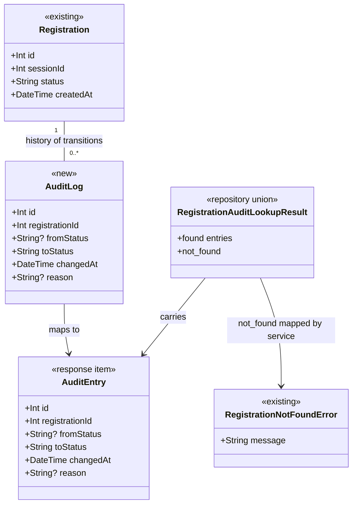

# Audit Log for Registration State Changes

## Requirements

Record every registration state change as an immutable audit entry, written atomically with the change itself, and let an organiser read the full chronological history of one registration through the API, so registration outcomes can be traced for reporting and dispute resolution.

Boundaries: a new `AuditLog` table related to `Registration` (`id`, `registrationId`, `fromStatus` nullable, `toStatus`, `changedAt`, `reason` optional); an entry written at each of the existing status write points (create as confirmed, create as waitlisted, cancel, promote); a read-only endpoint `GET /api/training-sessions/:id/registrations/:registrationId/audit` returning entries ordered by `changedAt` then `id`; 404 when the registration does not exist in that session. Audit entries are never updated or deleted through the API. Rejected operations (deadline passed, already cancelled, not found) are not state changes and write no entry. Out of scope: actor identity, UI page, log rotation or archival, backfilling history for registrations that predate the feature. Existing registration (LATC-2), waitlist (LATC-3), cancel (LATC-4), promotion (LATC-5), roster (LATC-6), deadline (LATC-7) and notification (LATC-8) behaviour and response contracts are unchanged.

## Entities

Existing structures stay unchanged: `status` remains a plain string, `CreateRegistrationResult` and `CancelRegistrationResult` keep their shapes, no wrapper entities are introduced. Allowed status values are the existing `confirmed | waitlisted | cancelled`; `fromStatus` additionally allows null (initial creation). Reason labels: `registered`, `waitlisted`, `promoted`, `cancelled`.

## Approach

1. Data model:
   - Add an `AuditLog` Prisma model following existing conventions: autoincrement `id`, snake_case table via `@@map("audit_logs")`, relation to `Registration`, index on `registrationId`. `changedAt` defaults to `now()`.
   - SQLite and plain strings, no enums, consistent with `Registration.status`.
   - History is not backfilled; a registration with no entries returns an empty list.

2. Write path (atomic recording):
   - Entries are written explicitly inside the existing `$transaction` callbacks at each write point, so atomicity needs no new transaction. A small helper `recordTransition(tx, registrationId, fromStatus, toStatus, reason)` in the repository layer performs the single `tx.auditLog.create`; all write points use it.
   - Explicit calls are chosen over Prisma middleware or database triggers because they are visible, unit-testable with the existing mocked transaction client, and work with the raw SQL and `updateMany` paths.
   - Entries are created only after the status change is confirmed to have taken effect (`create` succeeded, or `updateMany` count is 1), so concurrent losers and rejected operations never write an entry.
   - One cancel of a confirmed registration with a waiting person writes two entries in the same transaction: `confirmed -> cancelled` on the cancelled registration and `waitlisted -> confirmed` on the promoted one. If either fails, the whole transaction rolls back.

3. Read path:
   - Route parses ids (400 on NaN) and maps errors; service validates positive integers (ValidationError) and maps `not_found` to `RegistrationNotFoundError`; repository queries Prisma. Routes never touch Prisma.
   - The repository first looks up the registration scoped to both session id and registration id (like `getRegistration`); a mismatch is `not_found` (404). Then it lists entries ordered by `changedAt asc, id asc` (id breaks ties for entries in one transaction or the same millisecond).
   - Response is a direct JSON array of entries with the table fields. Dates serialise as ISO strings. An existing registration with no history returns 200 with `[]`. Cancelled registrations remain readable.

4. Immutability and error handling:
   - Immutability is enforced by exposing no audit write endpoint and no repository function that updates or deletes `AuditLog` rows (only `recordTransition` create and the list query). No database triggers.
   - Reuse existing error classes and the `{ error }` response format. Unexpected errors log and return 500 `{ error: 'Failed to fetch registration audit history' }`. The project's pattern is per-route try/catch mapping rather than a global handler, and this story follows it.

5. Delivery:
   - Red-Green-Refactor: write failing unit tests (mocked transaction client) and integration tests first, then minimal code. Update existing repository unit test mocks to include `auditLog.create`.
   - Seed script deletes audit entries before registrations to respect the foreign key.

## Structure

### Inheritance Relationships

1. `RegistrationNotFoundError` and `ValidationError` (existing, in `api/src/errors.ts`) are reused unchanged; no new error classes.
2. `AuditEntry` and `RegistrationAuditLookupResult` are plain TypeScript types/interfaces, no inheritance.

### Dependencies

1. `registrationRepository` (`api/src/repositories/registrationRepository.ts`) depends on `prisma` (`api/src/lib/prisma.ts`) and `Prisma.TransactionClient`; `claimSeatAndRegister`, `promoteFirstWaitlisted` and `cancelAndReleaseSeat` call `recordTransition`.
2. `registrationService` (`api/src/services/registrationService.ts`) calls the new repository function `listRegistrationAudit` and throws `ValidationError` / `RegistrationNotFoundError`.
3. The training-sessions router (`api/src/routes/training-sessions.ts`) calls the service function `getRegistrationAudit`.
4. `api/prisma/seed.ts` depends on the `auditLog` model for cleanup.

### Layered Architecture

1. Route layer: `GET /:id/registrations/:registrationId/audit` parses ids, calls the service, maps ValidationError to 400, RegistrationNotFoundError to 404, others to 500.
2. Service layer: validates ids, maps repository results to the response array, throws domain errors.
3. Repository layer: records audit entries inside the existing transactions and queries history; the only layer touching Prisma.
4. Data layer: Prisma `AuditLog` model on SQLite.
5. Error handling: per-route try/catch with the existing `{ error }` format (no GlobalExceptionHandler exists in this Express codebase).

## Operations

### Update Prisma schema - `api/prisma/schema.prisma`

1. Responsibility: add the `AuditLog` model and the back-relation.
2. Attributes:
   - `Registration`: add `auditLogs AuditLog[]`.
   - `AuditLog`: `id Int @id @default(autoincrement())`, `registrationId Int`, `fromStatus String?`, `toStatus String`, `changedAt DateTime @default(now())`, `reason String?`, `registration Registration @relation(fields: [registrationId], references: [id])`, `@@index([registrationId])`, `@@map("audit_logs")`.
3. Completion: `pnpm exec prisma db push` and `prisma generate` succeed; existing data is untouched.

### Update seed - `api/prisma/seed.ts`

1. Responsibility: keep seeding working with the new foreign key.
2. Logic: call `await prisma.auditLog.deleteMany()` before `prisma.registration.deleteMany()`.

### Update Repository - `api/src/repositories/registrationRepository.ts`

1. Responsibility: write audit entries atomically at every status write point and expose the history query.
2. Add helper `recordTransition(tx: Prisma.TransactionClient, registrationId: number, fromStatus: string | null, toStatus: string, reason: string): Promise<void>`
   - Logic: `await tx.auditLog.create({ data: { registrationId, fromStatus, toStatus, reason } })`.
3. Update `claimSeatAndRegister`:
   - After the waitlisted `tx.registration.create`, call `recordTransition(tx, registration.id, null, 'waitlisted', 'waitlisted')`.
   - After the confirmed `tx.registration.create`, call `recordTransition(tx, registration.id, null, 'confirmed', 'registered')`.
   - No entry on `not_found` or `deadline_passed` returns.
4. Update `promoteFirstWaitlisted`:
   - When `promoted.count === 1`, call `recordTransition(tx, candidate.id, 'waitlisted', 'confirmed', 'promoted')` before returning `candidate.id`.
   - When `count === 0` (competing change), loop again and write nothing.
5. Update `cancelAndReleaseSeat`:
   - After `updated.count === 1`, call `recordTransition(tx, registrationId, registration.status, 'cancelled', 'cancelled')` (covers confirmed and waitlisted origin).
   - Promotion entry is written inside `promoteFirstWaitlisted` (after the cancel entry, same transaction).
   - No entry for `not_found` or `already_cancelled`.
6. Add types and function:
   - `export type RegistrationAuditLookupResult = { status: 'found'; entries: AuditLog[] } | { status: 'not_found' }` (import `AuditLog` from `@prisma/client`).
   - `export async function listRegistrationAudit(sessionId: number, registrationId: number): Promise<RegistrationAuditLookupResult>`:
     - `prisma.registration.findFirst({ where: { id: registrationId, sessionId } })`; if null return `{ status: 'not_found' }`.
     - `prisma.auditLog.findMany({ where: { registrationId }, orderBy: [{ changedAt: 'asc' }, { id: 'asc' }] })`; return `{ status: 'found', entries }`.
7. Constraint: no function in this file updates or deletes `AuditLog` rows.

### Update Service - `api/src/services/registrationService.ts`

1. Interface: `export interface AuditEntry { id: number; registrationId: number; fromStatus: RegistrationStatus | null; toStatus: RegistrationStatus; changedAt: Date; reason: string | null }`.
2. `getRegistrationAudit(sessionId: number, registrationId: number): Promise<AuditEntry[]>`
   - Input validation: non-positive or non-integer `sessionId` throws `ValidationError('session id must be a positive whole number')`; same for `registrationId` with `'registration id must be a positive whole number'`.
   - Business logic: call `listRegistrationAudit`; on `not_found` throw `RegistrationNotFoundError`; otherwise map each row to `AuditEntry` (cast statuses via `RegistrationStatus`, no `any`).
   - Return value: ordered array, possibly empty.

### Update Route - `api/src/routes/training-sessions.ts`

1. Add `router.get('/:id/registrations/:registrationId/audit', ...)` (register it with the other registration routes; it does not collide with `/:id/registrations/:registrationId`).
2. Logic: `parseInt` both params, 400 `{ error: 'Invalid session ID' }` / `{ error: 'Invalid registration ID' }` on NaN; call `getRegistrationAudit`; `res.status(200).json(entries)`.
3. Errors: ValidationError 400, RegistrationNotFoundError 404, otherwise `console.error('Error fetching registration audit history:', error)` and 500 `{ error: 'Failed to fetch registration audit history' }`.
4. Do not add PUT, PATCH or DELETE routes for audit.

### Tests (write first, Red-Green-Refactor)

1. Unit, repository (`api/tests/unit/registrationRepository*.test.ts`): extend the mocked transaction client with `auditLog.create`; assert entries `(null, confirmed, registered)`, `(null, waitlisted, waitlisted)`, `(confirmed, cancelled, cancelled)`, `(waitlisted, cancelled, cancelled)`, `(waitlisted, confirmed, promoted)`; assert no entry for not_found, deadline_passed, already_cancelled, and lost conditional updates (count 0); assert `listRegistrationAudit` orders by changedAt then id and returns not_found on missing or mismatched session.
2. Unit, service: ids validated (400 cases), not_found maps to `RegistrationNotFoundError`, rows mapped.
3. Integration (`api/tests/integration/`): register then GET audit gives `[null->confirmed]`; waitlist gives `[null->waitlisted]`; cancel confirmed with waiter gives cancelled entry on the first and `[null->waitlisted, waitlisted->confirmed]` on the second; cancel waitlisted gives `waitlisted->cancelled`; chronological order; unknown registration 404; wrong-session 404; invalid ids 400; empty history 200 `[]`; entries unchanged between two reads; audit rows absent after a rejected late registration.

## Norms

1. Annotation/typing standards: strict TypeScript, no `any`; use `unknown` with narrowing, Prisma generated types, and the `RegistrationStatus` union for status values.
2. Dependency pattern: routes call services; services call repositories; only repository functions use Prisma. Transaction work uses the `tx: Prisma.TransactionClient` passed in, never the global client.
3. Exception handling: reuse `ValidationError` and `RegistrationNotFoundError`; map to HTTP in the route try/catch; responses use `{ error: string }`; log unexpected errors with `console.error` and return a generic 500 message with no internals.
4. Data validation: ids are positive integers (route NaN check, service integer check), consistent with `getRegistration`.
5. Naming and ordering: ordering convention `(timestamp asc, id asc)` as used for waitlist order; snake_case table name through `@@map`.
6. Logging: no logging of audit entry contents; errors use the existing `console.error('Error ...:', error)` form.
7. Testing: Red-Green-Refactor; unit tests with mocked repository/transaction client, integration tests against the database; `make test` and `make lint` must pass.
8. Documentation: comments only where intent is non-obvious (why entries are written only after a confirmed update).

## Safeguards

1. Functional constraints: exactly one audit entry per actual status change; none for rejected or no-op attempts; initial creation has `fromStatus: null`; a cancel that promotes writes two entries (one per registration) in the same transaction.
2. Performance constraints: at most one extra insert per status change inside the existing transaction; the history query uses the `registrationId` index; the existing 10s max wait and 15s timeout remain sufficient.
3. Security constraints: no secrets or `.env` access; no audit write, update or delete endpoint; the endpoint is read-only and returns only audit fields (no name or email); no new raw SQL, and the unsafe `/search` route is not touched.
4. Integration constraints: existing response contracts (register, waitlist, cancel, lookup, roster, session reads) and notification behaviour are unchanged; the new route does not shadow existing ones; no frontend change.
5. Business rule constraints: entry and change commit or roll back together; promotion is recorded on the promoted registration as `waitlisted -> confirmed`; cancellation of a waitlisted registration is recorded as `waitlisted -> cancelled`; cancelled registrations keep readable history.
6. Exception handling constraints: 404 for unknown registration or session mismatch, 400 for invalid ids, 500 generic message; error messages never expose Prisma or stack details.
7. Technical constraints: no `any`; no Prisma access in routes; no Prisma middleware or triggers; no `--no-verify`; schema change applied via `prisma db push` and client regeneration; seed cleanup deletes audit rows first.
8. Data constraints: `toStatus` is one of `confirmed | waitlisted | cancelled`; `fromStatus` is null or one of those; `reason` is one of `registered | waitlisted | promoted | cancelled` for all entries written by the app (column stays nullable); `changedAt` is set by the database default, never by client input.
9. API constraints: `GET /api/training-sessions/:id/registrations/:registrationId/audit` returns 200 with a JSON array of `{ id, registrationId, fromStatus, toStatus, changedAt, reason }` ordered by `changedAt` then `id`; 200 `[]` for no history; 400, 404 and 500 as above; no other audit methods or paths exist.
